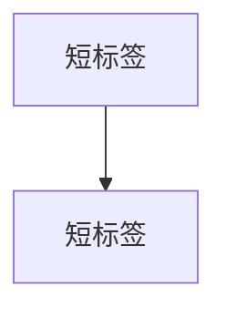

# DDIA 权衡卡（study cards）

把《设计数据密集型应用（第二版）》的权衡主题做成**手机优先的单页学习卡**：
一张卡只讲一个取舍，先给场景与约束、让你自己想方案，再揭示代价与反直觉之处，
配一张小图、两三道自测题，并链回原书对应小节。

- 在线预览：<https://c2j.github.io/ddia/cards/>
- 内容源：`cards/src/*.md`（一卡一文件）
- 构建产物：单文件 HTML（自包含，mermaid 走 CDN），无需后端

## 当前规模

共 **51 张卡**，覆盖第 1–13 章（沿用第二版章节编号）：

| 章 | 主题 | 张数 |
|----|------|------|
| 第1章 | 数据系统架构中的权衡 | 1 |
| 第2章 | 定义非功能性需求 | 2 |
| 第3章 | 数据模型与查询语言 | 3 |
| 第4章 | 存储与检索 | 5 |
| 第5章 | 编码与演化 | 2 |
| 第6章 | 复制 | 10 |
| 第7章 | 分片 | 4 |
| 第8章 | 事务 | 6 |
| 第9章 | 分布式系统的麻烦 | 4 |
| 第10章 | 一致性与共识 | 3 |
| 第11章 | 批处理 | 4 |
| 第12章 | 流处理 | 4 |
| 第13章 | 流式系统的哲学 | 3 |

## 三种卡片类型

- `P-` 困境卡：给场景与约束、不给选项；自己先想方案，再看揭示中的代价
- `S-` 推演卡：给运行/故障序列，逐步推演系统行为，先预测再看答案
- `I-` 事故档案卡：真实事故叙事，作为记忆钩子

## 文件格式

```markdown
id: P-4.1-01              # 类型-章.节-序号，全局唯一（浏览器端用作状态键）
type: dilemma             # dilemma | simulation | incident
chapter: §4.1 存储与检索   # 决定目录分组，须与正文章节号一致
title: 卡片标题

## 场景
...（困境卡/事故卡用「场景」，推演卡用「推演序列」）

## 你的问题
...

## 揭示
...（其中应包含一条"你可能没想到的"洞察）

## 图


## 自测
- 判断: 题干 [对] 或 [错]
- 单选: 题干 | 选项A | 正确选项* | 选项C

## 原文关联
- [§4.1 小节标题](/ch4/#anchor)
```

### 约定

- **id 全局唯一**：重复会让浏览器端的已读/收藏/答错状态串卡
- **chapter 字段**决定目录分组；目录里的「第N章 章名」与条目上的小节名
  从 `content/zh/chN.md` 自动读取，**不要手写章名映射**
- **原文关联**：格式 `/chN/#anchor`，锚点必须是 `content/zh/chN.md` 中
  真实存在的 `{#anchor}`；构建时按 `SITE_BASE` 自动补前缀
- **mermaid**：节点标签统一加引号；`subgraph` 写成 `subgraph ID["标题"]`
- **自测**：每张卡至少 2 题；判断题答案只允许「对」或「错」；单选题用 `*` 标记且只能一个
- 正文以具体场景开头，避免直接给结论；揭示里给反直觉洞察

## 构建与校验

仓库根目录提供了 Makefile 目标（推荐用这两个）：

```bash
make cards         # 由 cards/src/*.md 重新生成 static/cards/index.html
make cards-check   # 校验卡片内容，并确认产物与源一致（无漂移）
```

`make check` 已包含 `cards-check`，CI（`.github/workflows/cards.yml`）也会在
卡片、章节或 Makefile 变更时执行校验。产物漂移检查的含义是：
只要改了 `cards/src/` 却忘了重新生成，校验就会失败并提示运行 `make cards`。

也可以直接调用脚本：

```bash
# 本站（Hugo）发布形态：产物写进 static/，链接为站点根路径
CARDS_OUT=static/cards/index.html SITE_BASE= python3 cards/build.py
# 图标同级放置：static/cards/icon-192.png、static/cards/icon-512.png

# 独立部署形态：产物为 cards/index.html，链接按 /ddia 前缀
python3 cards/build.py

# 仅校验
python3 cards/check.py
```

Hugo 会把 `static/` 原样复制到站点根，因此产物可通过 `/cards/` 访问，
卡片内的「原文关联」直接指向本站的 `/chN/#anchor` 页面。

`check.py` 校验 frontmatter 字段、段落完整性、id 唯一（重复会导致浏览器端
已读/收藏状态串卡）、自测格式、mermaid 配对、原文关联锚点是否存在、
文件名与 id 是否一致。退出码非 0 时逐条列出问题。

## 许可与归属

- 图书原文与中文译文版权归原作者 Martin Kleppmann、Chris Riccomini 与出版社所有；
  译文仓库 [Vonng/ddia](https://github.com/Vonng/ddia) 以 **CC BY 4.0** 授权。
- 本目录的卡片为基于译文的**学习摘要与改编**，同样以 **CC BY 4.0** 提供，
  仅用于学习交流，不用于商业用途。转载或再改编请保留署名。
