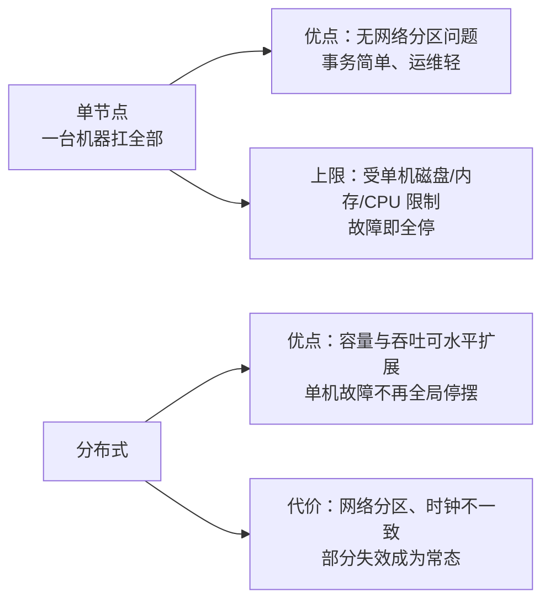

id: P-1.1-01
type: dilemma
chapter: §1.1 数据系统架构中的权衡
title: 单节点够用吗？还是必须上分布式

## 场景
新业务，预估 3 年数据量 200GB，峰值 QPS 2000，团队 4 人。
架构评审有人主张"一步到位上分布式"：分片、多副本、消息队列全上齐。

## 你的问题
现在该上分布式吗？判断依据是什么？上了会付出什么代价？

## 图
单节点与分布式的权衡：

## 揭示
- **判断依据是"单节点上限"是否真的成为瓶颈**，而不是"分布式更高级"。
  200GB / 2000 QPS 远在单机（现代服务器能轻松装下、能扛上万 QPS）范围内，
  此时上分布式买不到任何东西，只买到问题。
- **分布式的代价不是"多一点运维"，是一整类新故障模式**：
  网络分区、部分失效、时钟不可信、跨节点一致性。
  第 9 章整章都在讲"这些不确定性无法被消除"。
  在不需要扩展时引入它们，是用确定的复杂度换不存在的收益。
- **你可能没想到的**：DDIA 第 1 章把"分布式 vs 单节点"直接列为一种架构权衡，
  与"云服务 vs 自托管""分析型 vs 事务型"并列——
  说明**"要不要分布式"是一个有正确答案的技术判断，不是品味问题**。
  正解通常是：单节点能做到就用单节点（配合良好的备份与快速恢复），
  规模真的压过来时再拆，而且要按负载类型（读/写/容量）分别判断拆什么。
- **配套判断**：可以先把无状态的 API 层横向扩，把存储留在单节点，
  这样能扩展最常见的瓶颈（并发连接）而不引入分布式存储的一致性问题。

## 自测
- 单选: 判断是否需要分布式存储的首要依据是什么？ | 团队规模 | 单节点在容量/吞吐上是否已成为真实瓶颈* | 竞品是否用了 | 数据是否重要
- 判断: 引入分布式后，网络分区与部分失效问题可以通过工程手段彻底消除。 [错]

## 原文关联
- [§1.3 分布式与单节点系统](/ch1/#sec_introduction_distributed)
- [§1.2 云服务与自托管](/ch1/#sec_introduction_cloud)
- [§1.1 分析型与事务型系统](/ch1/#sec_introduction_analytics)
