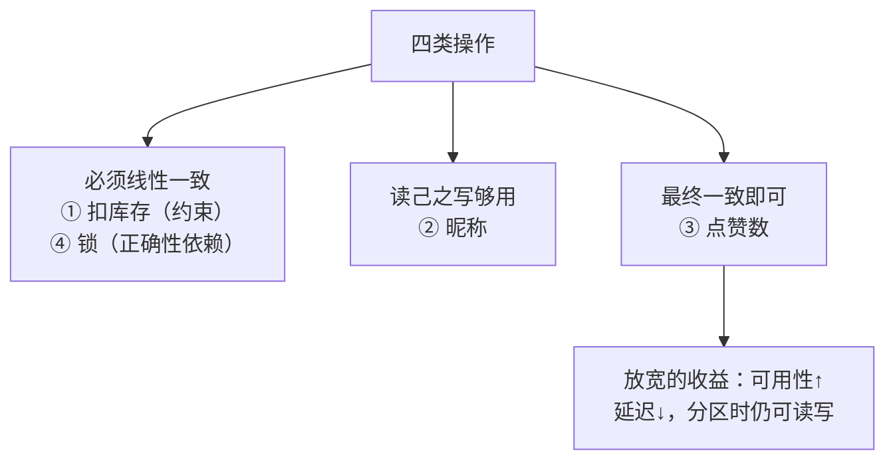

id: P-10.1-01
type: dilemma
chapter: §10.1 一致性与共识
title: 抢库存要线性一致吗？先分清哪些操作真的需要

## 场景
电商系统分布式集群，这些操作哪些要求线性一致（看起来像只有一份数据）？

① 秒杀扣减库存（不能超卖）
② 用户改自己的昵称后立刻刷新页面要看到新昵称
③ 朋友圈点赞数展示
④ 分布式锁的获取与释放

## 你的问题
逐一判断：哪些必须线性一致？哪些可以放宽？放宽的收益是什么？

## 图
一致性需求分层：

## 揭示
- **判断标准：操作结果是否参与"正确性约束"或被其他正确性依赖**。
  扣库存违反就是资损（超卖）；锁不线性一致等于没锁。
  而昵称只要"自己看得到自己改的"（读己之写），
  点赞数偏差几个根本无人在意（最终一致）。
- **放宽的收益真实且巨大**：线性一致要求读写都经过最新的数据副本，
  主节点挂了要等切换（不可用）；最终一致在分区时各副本仍可独立读写。
  CAP 定理说的就是这个：**网络分区时，线性一致与可用性二选一**。
- **你可能没想到的**：大部分系统 99% 的读不天然需要线性一致，
  真正需要的是少数关键路径。**把一致性当成本来付费，只为必要操作付费**，
  是分布式系统设计的第一堂经济学。

## 自测
- 单选: 以下哪个操作最不能放宽一致性？ | 朋友圈点赞数 | 秒杀扣库存* | 推荐列表 | 浏览计数
- 判断: 网络分区发生时，系统可以同时保证线性一致和完全可用。 [错]

## 原文关联
- [§10.1 线性一致性](/ch10/#sec_consistency_linearizability)
- [§10.1 依赖线性一致性](/ch10/#sec_consistency_linearizability_usage)
- [§10.1 CAP 定理](/ch10/#the-cap-theorem)
