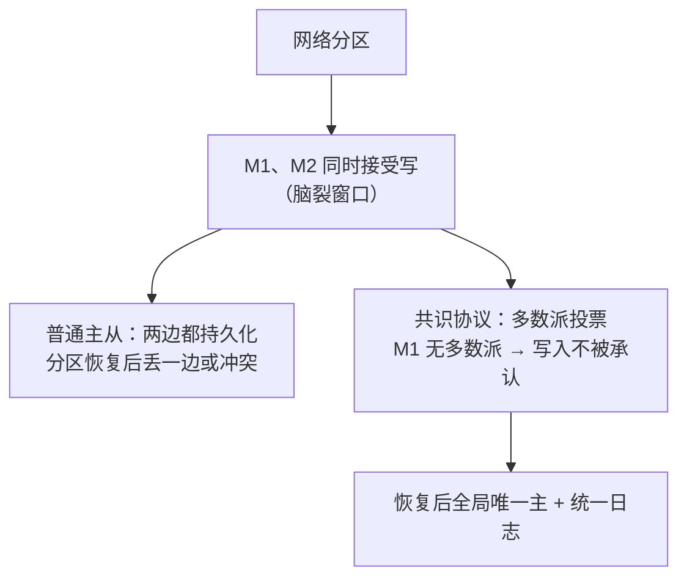

id: P-10.3-01
type: dilemma
chapter: §10.3 一致性与共识
title: 两个节点都说自己是主：脑裂怎么办？

## 场景
主从复制集群。网络分区：主 M1 与多数派失联，但还能响应部分客户端。
监控判定 M1 超时，选举出 M2。短暂窗口内 M1 和 M2 都在接受写入。

## 你的问题
这个窗口的写入会有什么后果？共识协议（如 Raft）靠什么杜绝它？

## 图
脑裂窗口与共识的防护：

## 揭示
- **普通主从的窗口不是 bug 而是设计空白**：M1 不知道自己已被罢免
  （它的"失联"可能只是监控侧的误判），继续接受写入。
  分区恢复后，两份互相矛盾的"真相"必须丢一边。
- **共识协议的两道锁（你可能没想到的第二道）**：
  ① **任期 + 多数派**：M2 需要 2/3 节点投票才能上任，M1 拿不到多数派，
  它的写入永远无法被提交（commit 需要多数派确认）；
  ② **更高的任期号**：分区恢复后 M1 看到比自己新的任期号，立刻退位。
  注意：即使 M1 暂时还没收到新任期消息，它的写入也因缺多数派确认而无效——
  **正确性不依赖"罢免消息及时送达"**，这是与 fencing token 思想同源的防线。
- **代价**：共识要求多数派在线，2 节点集群容不了 1 节点故障
  （2/2 投不出多数派）。所以共识集群用 3 或 5 个节点。

## 自测
- 单选: 共识协议中，旧主在分区的少数派一侧的写入为什么会失效？ | 被防火墙拦截 | 无法获得多数派确认，不会被提交* | 时间戳过期 | 磁盘故障
- 判断: 3 节点的共识集群可以容忍 2 个节点同时故障。 [错]

## 原文关联
- [§10.3 从单主复制到共识](/ch10/#from-single-leader-replication-to-consensus)
- [§10.3 共识的微妙之处](/ch10/#subtleties-of-consensus)
- [§10.3 共识的利弊](/ch10/#pros-and-cons-of-consensus)
