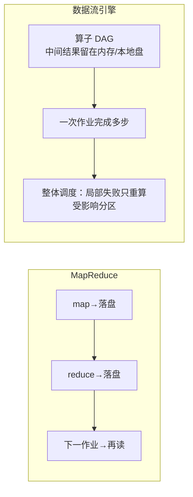

id: P-11.1-02
type: dilemma
chapter: §11.1 批处理
title: 从 Hadoop 到数据流引擎：为什么大家都在抛弃 MapReduce？

## 场景
团队用 MapReduce 做 10 步的 ETL 工作流。问题：

1. 每步都要读写 HDFS，10 步 = 10 轮完整落盘
2. 中间结果只是给下一步用，却要复制 3 份（HDFS 副本）
3. 某步失败要重跑整步

## 你的问题
数据流引擎（Spark/Flink/Tez）做了什么改变来消除这些开销？

## 图
MapReduce vs 数据流引擎的执行模型：

## 揭示
- **核心变化是把"作业"变成"算子图（DAG）"**：
  整个工作流表达为一个 DAG，引擎统一调度，
  中间结果**不落 HDFS**，而是待在内存或用本地磁盘溢出文件。
  避免每步物化到分布式文件系统（省掉了写副本 + 下次读的两次代价）。
- **调度粒度变细**：MapReduce 以"整个作业"为失败单位，
  数据流引擎以"分区/算子"为单位，局部失败只重算受影响的分区。
- **你可能没想到的**：数据流引擎仍然会落盘——只是**有选择的落盘**，
  在 shuffle 边界和 checkpoint 处落，而不是每一步都落。
  落盘的目的是**容错**（血统 lineage 重算也需要重放点）。
  本质权衡没变：**容错成本 vs 恢复速度**——
  多落盘 = 恢复快但慢；少落盘 = 快但失败后要重算更多。

## 自测
- 单选: 数据流引擎相比 MapReduce 的主要优化是什么？ | 更强的 CPU | 中间结果不物化到 HDFS，算子组成 DAG 统一调度* | 不需要 shuffle | 不用容错
- 判断: Spark 这类引擎完全不落盘，所有中间数据都在内存。 [错]

## 原文关联
- [§11.3 数据流引擎](/ch11/#sec_batch_dataflow)
- [§11.3 MapReduce](/ch11/#sec_batch_mapreduce)
- [§11.3 混洗数据](/ch11/#sec_shuffle)
