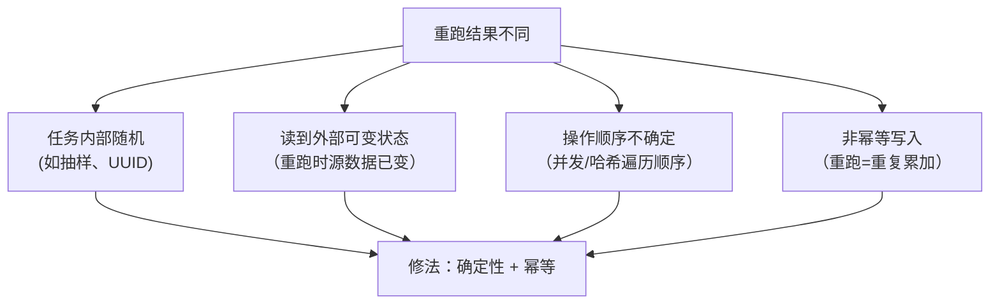

id: P-11.2-01
type: dilemma
chapter: §11.2 批处理
title: 每次重跑结果都不同：批处理也会"不确定"

## 场景
每日报表任务：读事件日志 → 按用户聚合 → 写结果表。
某天线上排查发现：同一天的数据**重跑两次，结果不一样**（差几千条）。

代码里没有任何随机数。也没有 SQL 的 LIMIT 之类。

## 你的问题
不引入随机性，重跑结果为什么会不同？批处理的"确定性"边界在哪？

## 图
不确定来源的分类：

## 揭示
- **批处理"可重跑"的前提是确定性与幂等**，而不是"批处理本身天然可重跑"。
  常见真实原因：
  ① **读到会变的源数据**：任务跑的时候上游还在写入，重跑时窗口内的数据变了；
  ② **非幂等输出**：结果表用 `INSERT` 追加而不是按分区覆盖，
  重跑就把同一批数据算了两遍（最典型的"差几千条"）；
  ③ **聚合顺序/并发导致的浮点或 tie-break 差异**。
- **工程正解（你可能没想到的）**：
  输出按**分区原子覆盖**（同一天的结果目录整体替换，而不是追加），
  所有写入设计成**幂等**（相同输入重复执行结果不变）。
  Flink/Spark 的 checkpoint、Hive 的 `INSERT OVERWRITE PARTITION` 都是这个思想。
- **引申**：这就是"恰好一次处理"的真相——分布式系统里没有真正的"恰好一次"
  执行，只有**幂等 + 原子提交**模拟出的效果等价。

## 自测
- 单选: 批处理任务重跑导致结果翻倍，最可能的原因是？ | CPU 不稳定 | 输出用追加写入而非分区原子覆盖（非幂等）* | 数据量变大 | 磁盘故障
- 判断: 批处理任务天然可重跑，无需担心重复执行的影响。 [错]

## 原文关联
- [§11.4 批处理用例](/ch11/#sec_batch_output)
- [§11.2 工作流调度](/ch11/#sec_batch_workflows)
- [§11.4 对外提供衍生数据](/ch11/#sec_batch_serving_derived)
