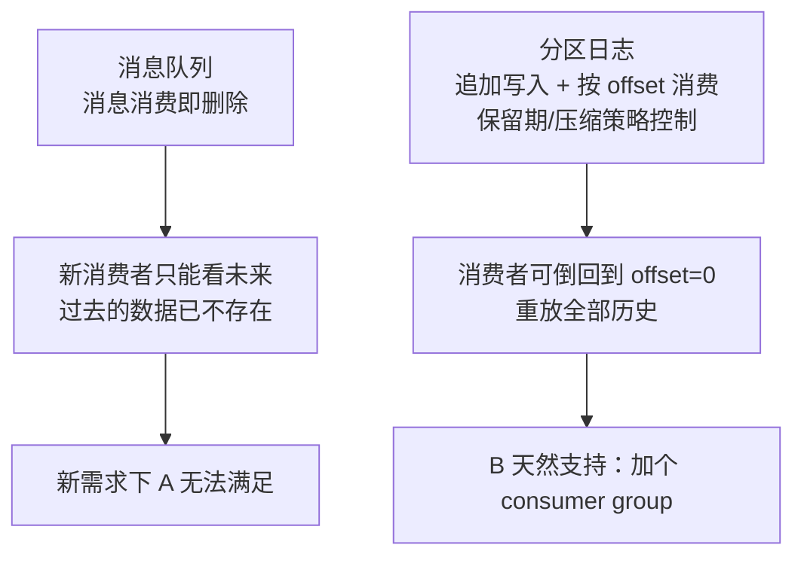

id: P-12.1-01
type: dilemma
chapter: §12.1 流处理
title: 消息队列 vs 事件日志：谁记住发生了什么？

## 场景
订单系统要广播"订单已创建"事件给 5 个下游（风控、库存、通知、分析、对账）。
候选：

- 方案 A：RabbitMQ（传统消息队列，消息被消费后删除）
- 方案 B：Kafka（分区日志，消息保留可重放）

新需求来了：下游新增了对账服务，**它需要处理过去 30 天的全部事件**。

## 你的问题
两种方案在这个新需求下的差异有多大？根本区别是什么？

## 图
两种传递模型的核心差异：

## 揭示
- **根本区别在"谁控制消费进度"**：消息队列里 Broker 负责删除
  （消息一旦被确认就消失）；日志里**消费者自己维护 offset**，
  Broker 只管保留（按时间或大小）。
  这一个差异带来了巨大的能力差。
- **日志模型的能力**：新增消费者可以**从头重放**；
  消费者挂掉重启不影响别人（各自的 offset）；
  同一个日志可以派生多个独立视图（派生数据思想的基础）。
- **代价（你可能没想到的）**：
  ① 日志保留期 = 你必须为"可重放"付存储成本，
  无限保留不现实，要靠**日志压缩**（key 相同只留最新）来控；
  ② offset 的管理责任转移给了消费者——
  提交 offset 的时机决定"至少一次"还是"最多一次"语义；
  ③ 消息队列的"消费即删"反过来是优点：无需管理保留策略和磁盘水位。

## 自测
- 单选: 日志模型能给新消费者重放历史，根本原因是什么？ | 消息更大 | 消息按 offset 保留，消费进度由消费者维护* | Broker 更强 | 用了 SSD
- 判断: 事件日志可以无限保留所有历史消息而无需额外考虑。 [错]

## 原文关联
- [§12.1 传递事件流](/ch12/#sec_stream_transmit)
- [§12.1 日志与传统消息传递的比较](/ch12/#sec_stream_logs_vs_messaging)
- [§12.1 消费者偏移量](/ch12/#sec_stream_log_offsets)
