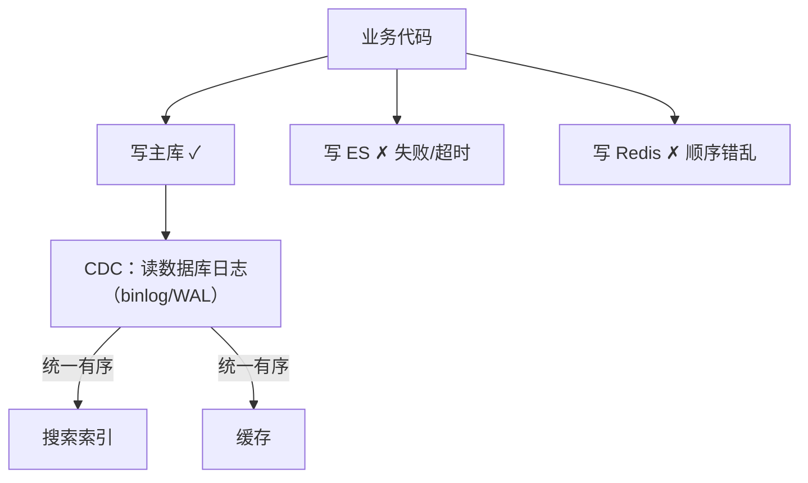

id: P-12.2-01
type: dilemma
chapter: §12.2 流处理
title: 变更数据捕获：为什么不要双写

## 场景
服务要把订单数据同步到搜索索引和缓存。团队方案：
**在业务代码里同时写数据库、写 ES、写 Redis**（双写/三写）。

## 你的问题
这个方案会在什么情况下不一致？CDC（变更数据捕获）如何根治？

## 图
双写 vs CDC：

## 揭示
- **双写的三个致命问题**：
  ① **无原子性**：主库写成功、ES 写失败 → 数据不一致，且没有自动修复；
  ② **顺序无保证**：并发请求下 ES 的写入顺序可能与主库提交顺序不同，
  后写的旧值可能覆盖新值；
  ③ **逻辑分叉**：每个下游都要在业务代码里维护，
  新增下游 = 改业务代码 = 高耦合。
- **CDC 的做法**：把数据库的复制日志（binlog/WAL）
  当成事件流读取——**因为日志本身就是按提交顺序排列的**，
  CDC 天然继承了主库的顺序与一致性。业务代码只写主库。
- **你可能没想到的（真正的本质）**：
  CDC 让"数据库"和"下游派生视图"变成**同一份数据的不同视图**，
  而这正是 DDIA 全书的主线论点——**派生数据必须由单一事实来源
  的唯一有序日志驱动**。多写就是在制造多个互相矛盾的"事实来源"。
  这也是为什么端到端一致性（end-to-end argument）指向"从事件日志派生一切"。

## 自测
- 单选: 双写导致数据不一致的根本原因是什么？ | 网络慢 | 缺少跨系统的原子性与顺序保证* | 磁盘故障 | 编程语言问题
- 判断: CDC 从数据库复制日志读取变更，因此天然继承了提交顺序。 [对]

## 原文关联
- [§12.2 变更数据捕获](/ch12/#sec_stream_cdc)
- [§12.2 保持系统同步](/ch12/#sec_stream_sync)
- [§12.2 从同一事件日志中派生多个视图](/ch12/#sec_stream_deriving_views)
