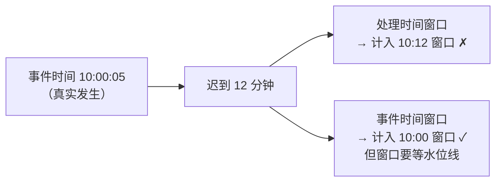

id: P-12.3-01
type: dilemma
chapter: §12.3 流处理
title: 事件时间 vs 处理时间：迟到的事件算哪个窗口？

## 场景
统计"每分钟下单量"。某事件发生在 10:00:05，
但由于客户端离线，10:12 才上传到服务端。

流处理作业用**处理时间**做窗口聚合。

## 你的问题
这条事件会被算进哪个窗口？结果会有什么问题？换成事件时间呢？

## 图
两种时间的差异：

## 揭示
- **处理时间的结果不稳定且不可重放**：同一条数据在不同时间到达，
  会落入不同窗口，导致**同一份数据重跑结果不同**；
  离线补传、网络抖动、消费滞后都会让"每分钟下单量"波动失真。
- **事件时间给出稳定答案**，但代价是：
  ① 必须**等**——得知道"10:00 的事件都到齐了"才能关闭窗口，
  这个判断靠**水位线（watermark）**，本质上又是一个"用启发式猜测代替事实"
  （和 ch9 的超时、ch6 的时钟问题同源）；
  ② 水位线设太紧 → 迟到数据被丢弃；设太松 → 结果延迟很久才出；
  ③ 通常给一个**允许迟到窗口**，超时的事件走"侧输出"再人工处理。
- **你可能没想到的**：这就是"流处理为什么难"的核心——
  批处理里"输入固定"这个前提消失了，
  你必须在**结果延迟**与**结果完整性**之间做选择，
  而且要显式地做出选择（水位线策略就是那个选择）。

## 自测
- 单选: 用处理时间做窗口聚合的最大问题是什么？ | 太慢 | 结果依赖到达时间，不可重放且不稳定* | 内存不足 | 无法并行
- 单选: 事件时间窗口靠什么判断"这个窗口的数据到齐了"？ | 系统时钟 | 水位线（watermark）* | 分片数 | 消费者 offset

## 原文关联
- [§12.3 时间推理](/ch12/#sec_stream_time)
- [§12.3 事件时间与处理时间](/ch12/#id322)
- [§12.3 处理滞留事件](/ch12/#id323)
