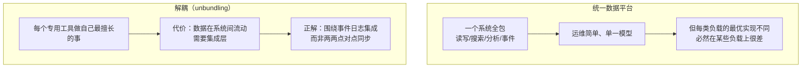

id: P-13.1-01
type: dilemma
chapter: §13.1 数据的未来
title: 全公司一个"数据湖"通吃，还是要拆成一堆专用工具？

## 场景
公司现状：MySQL 存业务、ES 做搜索、Redis 做缓存、ClickHouse 做分析、
Kafka 做事件。新架构师提议：**全公司统一到一个"数据湖/hub"**，
消灭所有专用系统。

## 你的问题
"统一"的收益与代价各是什么？为什么 DDIA 的结论恰恰相反（unbundling）？

## 图
统一 vs 解耦：

## 揭示
- **没有一种存储对全部负载都最优**——这是第 I 部分的结论
  （OLTP 行存 vs 列存 vs 倒排索引 vs 向量索引，物理布局需求互斥）。
  统一必然意味着在所有非最优负载上付代价。
- **解耦的代价是集成**，而且是 N² 的点对点集成（5 个系统 = 20 条同步链路，
  每条都要处理顺序、重试、一致性问题）。这才是"统一平台"诱人的真正原因。
- **DDIA 的答案（你可能没想到的）**：
  解耦本身没错，错的是用点对点同步来集成。
  **正确做法是围绕一条（或少数几条）有序事件日志做集成**：
  每个系统订阅日志派生自己的视图，单向流动、无环、可重放。
  这样既保留了专用工具的各自最优，又把 N² 集成收敛成 N 条订阅。
  "组合使用数据存储技术"的核心约束就是**派生关系必须是单向无环的**。

## 自测
- 单选: 解耦多个专用数据系统后，真正需要解决的核心问题是什么？ | 硬件成本 | 系统间集成（数据流动、顺序与一致性）* | 团队人数 | 数据库版本
- 判断: 派生数据的方向允许出现环路，只要最终收敛即可。 [错]

## 原文关联
- [§13.1 数据集成](/ch13/#sec_future_integration)
- [§13.1 通过衍生数据组合专用工具](/ch13/#id442)
- [§13.2 组合使用数据存储技术](/ch13/#id447)
