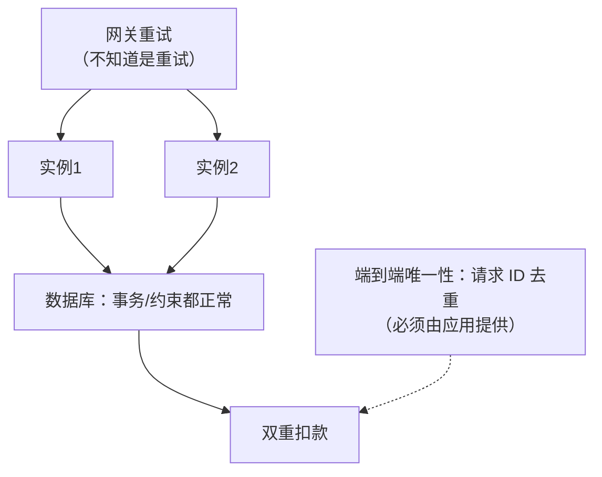

id: P-13.2-01
type: dilemma
chapter: §13.2 数据的未来
title: 数据库自己保证不了正确性：端到端原则

## 场景
系统做得"很安全"：数据库有唯一约束和事务，
消息队列有恰好一次投递，应用用乐观锁防并发。

结果还是出了双重转账：用户点两次提交按钮，网关重试了一次，
两次请求被负载均衡分到不同实例，各自读到相同余额、各自扣款成功。

## 你的问题
每一层都"正确"，为什么整体还是错的？谁该负责？

## 图
各层保证与端到端保证的落差：

## 揭示
- **每个组件只对自己的边界负责**，而错误是跨边界发生的。
  消重需要"同一请求只执行一次"这个**端到端**的属性，
  但数据库不知道两次调用是同一个业务请求——除非应用把
  **幂等键（请求 ID）** 传进来并在同一事务里记录。
- **这就是端到端原则（end-to-end argument）**：
  正确性属性必须在最外层（知道业务语义的那一层）强制，
  底层只能提供原语（事务、唯一约束），不能替应用做判断。
- **你可能没想到的**：这条原则反过来解释了为什么"端到端一致性"
  要在数据流层面做——**只有沿整条链路传递唯一标识，
  才能让最末端的写入具备去重能力**。所以 DDIA 第 13 章把
  "数据的端到端原则"和"及时性与完整性"放在一起讲：
  正确性不是某一层的属性，而是全链路的属性。

## 自测
- 单选: 数据库无法阻止双重扣款的根本原因是什么？ | 事务太弱 | 它不知道两次请求属于同一业务操作，去重必须由应用提供唯一 ID* | 锁不够 | 网络太慢
- 单选: "强制约束"为什么需要端到端视角？ | 为了性能 | 约束的正确性依赖业务语义，只有链路端点知道* | 为了兼容旧系统 | 为了减少存储

## 原文关联
- [§13.3 追求正确性](/ch13/#sec_future_correctness)
- [§13.3 数据库的端到端原则](/ch13/#sec_future_end_to_end)
- [§13.3 强制约束](/ch13/#sec_future_constraints)
