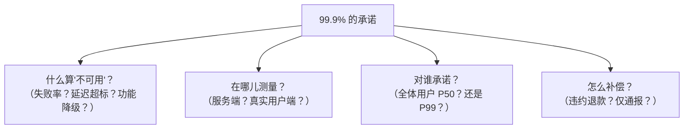

id: P-2.1-01
type: dilemma
chapter: §2 定义非功能性需求
title: "可用性 99.9%" 到底承诺了什么？

## 场景
产品要求"系统可用性 99.9%"。团队对这句话的理解产生了分歧：
A 说全年停机不能超过 8.76 小时；B 说只要主流程能用就行；
C 问"部分用户失败算不算不可用"。

## 你的问题
写 SLA 时必须明确哪几个问题？漏掉会怎样？

## 图
一个可执行的 SLA 必须回答的四个问题：

## 揭示
- **可用性是分位数游戏**：服务端平均 99.9% 可用时，
  尾部用户体验可能糟糕得多（比如某机房用户 100% 失败）。
  严肃的 SLA 用请求成功率 + 延迟分位数（P99）定义，且**在客户端测量**——
  服务端看到的永远比用户实际经历的乐观。

- **容错的悖论（你可能没想到的）**：向系统里添加冗余以提高可靠性，
  同时也引入了新的故障源（多副本一致性、故障检测误判、更复杂的切换逻辑）。
  缓解得当是净收益，设计草率反而降低可靠性。
  "多加几台机器"不自动等于"更可靠"。

- **工程含义**：SLA 的每一句话都对应可测量的指标和自动告警，
  否则它只是营销文案。写 SLA 的过程就是设计监控体系的过程。

## 自测
- 判断: 服务端统计的可用性达到 99.9%，用户实际体验就一定是 99.9%。 [错]
- 单选: 为提高可靠性引入冗余，可能带来什么副作用？ | 必然提高可靠性 | 新增故障源（一致性/误判/切换复杂度），设计不当反而降低可靠性* | 只影响成本 | 无影响

## 原文关联
- [§2.2 描述性能](/ch2/#sec_introduction_percentiles)
- [§2.3 可靠性与容错](/ch2/#sec_introduction_reliability)
- [§1.1 分析型与事务型系统](/ch1/#sec_introduction_analytics)
