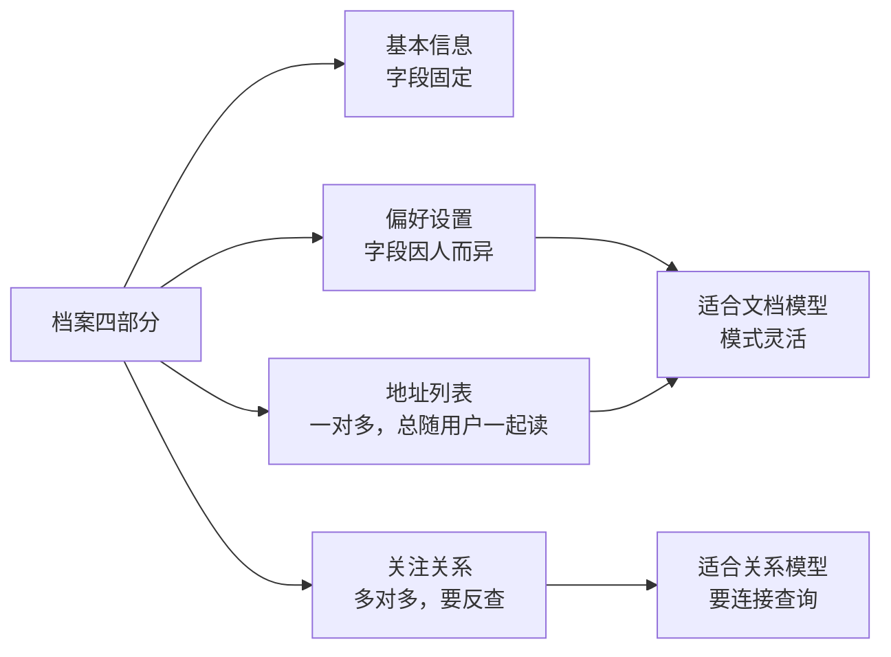

id: P-3.1-01
type: dilemma
chapter: §3.1 数据模型与查询语言
title: 用户档案：关系表还是文档 JSON？

## 场景
设计用户档案：基本信息（姓名、注册时间）+ 偏好设置（几十个键值对，
不同用户字段差异大）+ 常用地址列表（一对多）+ 关注的人（多对多）。

团队争论：A 说放 PostgreSQL 一个 jsonb 字段；B 说全部建关系表；
C 说用 MongoDB。

## 你的问题
档案的四个部分，哪些适合文档模型，哪些必须关系化？判断依据是什么？

## 图
判断标准：数据的关联形状决定模型选择：

## 揭示
判断依据不是"技术潮流"，是两个问题：

- **数据是否有统一模式**：偏好设置字段因人而异，关系表要么几百列
  大量为空，要么频繁改表结构。文档模型天然适配。
  地址列表虽然是一对多，但**总是随用户整体读取**，
  内嵌进文档避免了连接，反而更合适。

- **是否需要从"多"的一方反查**：关注关系是典型多对多，
  "查某人被谁关注"这种反向查询在文档内嵌里做不了，
  必须独立成关系表（或图数据库的边）。

- **你可能没想到的**：混合是最诚实的答案——
  PostgreSQL 一张表，基础字段做列，偏好和地址做 jsonb，
  关注关系独立成表。PostgreSQL 12+ 的 jsonb 索引让这种混合几乎没有惩罚。
  "选 A 还是选 B"经常是伪问题，按数据的关联形状逐部分决定。

## 自测
- 判断: 一对多的数据必须建独立的关系表，文档内嵌是错误做法。 [错]
- 单选: 判断文档 vs 关系模型的核心依据是什么？ | 团队技术栈 | 数据的关联形状与是否需要反向连接查询* | 数据量大小 | 数据库License

## 原文关联
- [§3.1 关系模型与文档模型](/ch3/#sec_datamodels_history)
- [§3.1 何时使用哪种模型](/ch3/#sec_datamodels_document_summary)
- [§3.1 规范化、反规范化与连接](/ch3/#sec_datamodels_normalization)
