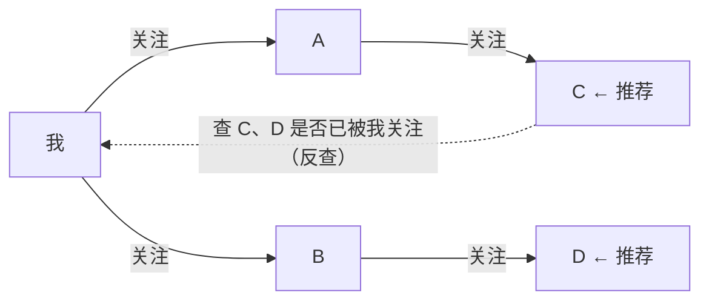

id: P-3.2-01
type: dilemma
chapter: §3.2 数据模型与查询语言
title: 社交关系查询：SQL 三层嵌套还是图查询？

## 场景
社交产品要实现："找到我关注的人**所关注的**、且我还没关注的人"
（二度人脉推荐）。

数据：用户表 + 关注关系表（follower_id, followee_id），MySQL。

## 你的问题
SQL 写这个查询会有多复杂？如果产品还要"最小间隔链路"
（我和某人的关注链条），SQL 还可行吗？

## 图
二度人脉在两种模型中的表达：

## 揭示
- **SQL 能写，但很痛苦**：二度人脉 = 关注表自连接两次 + NOT IN 反查 +
  去重。三层嵌套后可读性崩塌。更大的问题是**每加一层关系，查询复杂度翻倍**：
  三度人脉的 SQL 已不适合人类维护。

- **图模型的本质优势**：把"关注"表达为统一的边，
  任何深度的遍历都是同一个查询模式换个参数（Cypher 里 `*1..3` 就是最多三跳）。
  查询复杂度不随深度指数增长。

- **你可能没想到的**：如果只在 MySQL 上做，工程解法不是硬写 SQL，
  而是**预计算**：离线跑批生成二度人脉推荐表，线上只是点查。
  图查询引擎（Neo4j）适合关系探索型业务（风控图谱、知识图谱）；
  简单二度推荐用预计算表更便宜。模型选择要连同**查询频率与深度**一起考虑。

## 自测
- 判断: 图数据库的核心优势是查询语法更时髦。 [错]
- 单选: 关系遍历深度不确定（如最短关注链路）时，最适合的模型是？ | 关系表自连接 | 图遍历查询* | 全表扫描 | 预计算所有链路

## 原文关联
- [§3.2 图数据模型](/ch3/#sec_datamodels_graph)
- [§3.2 Cypher 查询语言](/ch3/#id57)
- [§3.2 SQL 中的图查询](/ch3/#id58)
