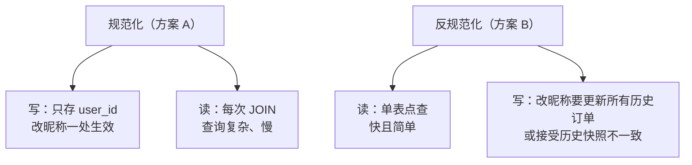

id: P-3.3-01
type: dilemma
chapter: §3.3 数据模型与查询语言
title: 订单表反规范化：冗余一列省一个 JOIN，值不值？

## 场景
订单表 orders(user_id, ...)，页面要显示"下单人昵称"。
昵称在 users 表里，且**可修改**。

方案 A：查询时 JOIN users 取最新昵称。
方案 B：下单时把昵称冗余存进 orders（反规范化）。

## 你的问题
方案 B 的好处和风险分别是什么？什么条件下选 B？

## 图
规范化与反规范化的写读权衡：

## 揭示
- **方案 B 的本质是回答一个业务问题**："订单页显示的昵称"是
  **当前昵称**还是**下单时刻的昵称**？
  如果是后者（电商惯例），方案 B 不但不是妥协，反而是**正确的业务建模**——
  下单那一刻的快照本来就不该随用户改名而变化。
- **如果业务要当前值**：反规范化带来更新风暴（改昵称更新百万订单行），
  方案 A 正确；折中是冗余 user_id + JOIN，或应用层缓存。
- **你可能没想到的**：反规范化的真正风险不是存储空间，
  是**写入路径增多后的一致性维护**——多个写入点都改冗余列时，
  漏改一处就是数据不一致，而且这种不一致静默存在。
  反规范化的前提是：冗余列的更新路径收敛到唯一一处（或由事件流统一驱动）。

## 自测
- 单选: 电商订单页显示"下单时昵称"，正确的建模是？ | JOIN users 取当前值 | 下单时快照冗余进订单表* | 每次改昵称回填所有订单 | 不显示昵称
- 判断: 反规范化的主要风险是存储空间占用翻倍。 [错]

## 原文关联
- [§3.1 规范化、反规范化与连接](/ch3/#sec_datamodels_normalization)
- [§3.1 多对一与多对多关系](/ch3/#sec_datamodels_many_to_many)
