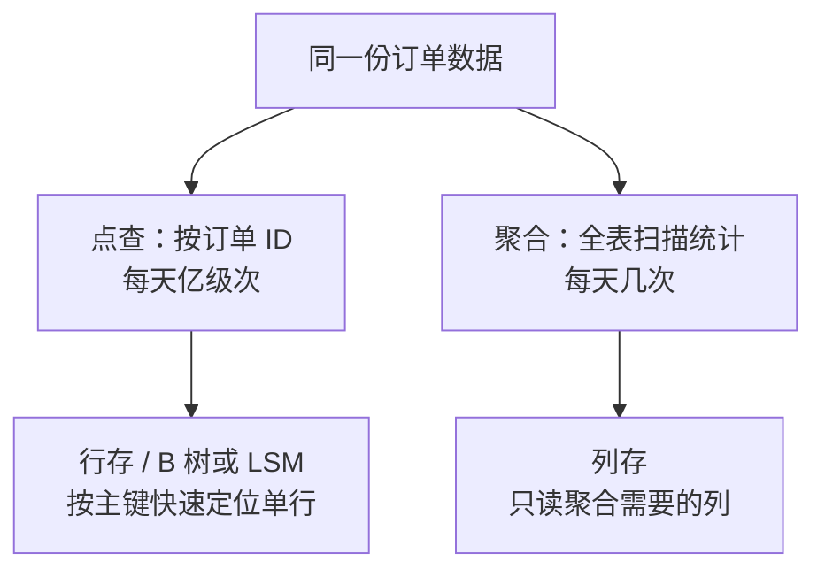

id: P-4.1-01
type: dilemma
chapter: §4.1 存储与检索
title: 记录最近订单，用什么存储引擎？

## 场景
电商系统，订单表两种访问模式并存：

1. **下单页**：根据订单 ID 查单个订单详情（点查），每天亿级次
2. **运营报表**：扫全表按用户聚合消费金额，每天跑几次

约束：同一份数据，两种模式性能都要可接受。

## 你的问题
用行存（B 树）还是列存（LSM/列式）？还是两套系统？先给方案再看揭示。

## 图
两种访问模式与存储引擎的匹配：

## 揭示
- **单引擎兼顾是陷阱**：行存做全表聚合要读所有列的所有页，I/O 放大几十倍；
  列存做单行点查要读所有列段再拼行，延迟差几个数量级。都不是"慢一点"，是"没法用"。

- **主流答案：同一逻辑数据的两份物理表示**。OLTP 库（B 树或 LSM）承接点查和写入，
  CDC/ETL 同步到列存数仓跑分析。这就是第 I 部分 OLTP/OLAP 分野的工程落地。

- **你可能没想到的**：选 B 树还是 LSM，取决于写入比例。订单表写多读也多，
  LSM 的顺序写优势明显；但读放大（要查多层 SSTable）需要布隆过滤器缓解。
  没有免费选项，只有匹配负载的选择。

## 自测
- 判断: 列存数据库做按主键的单行点查和行存一样快。 [错]
- 单选: 订单表写入量很大、点查延迟要求高，选哪种引擎更匹配？ | B 树 | LSM 树（配布隆过滤器）* | 列存 | 纯内存哈希表

## 原文关联
- [§4.1 OLTP 系统的存储与索引](/ch4/#sec_storage_oltp)
- [§4.2 分析型数据存储](/ch4/#sec_storage_analytics)
- [§4.1 比较 B 树与 LSM 树](/ch4/#sec_storage_btree_lsm_comparison)
