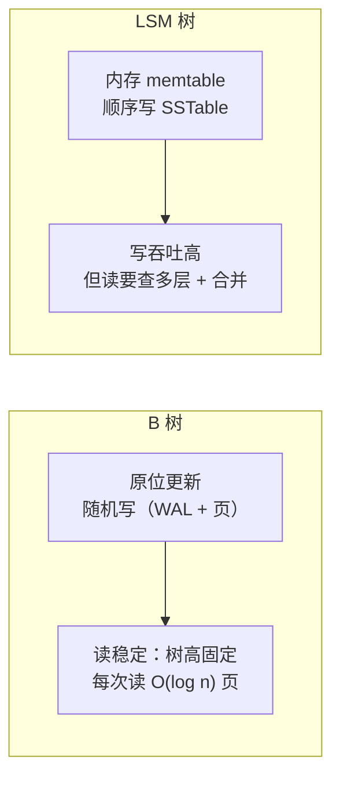

id: P-4.1-02
type: dilemma
chapter: §4.1 存储与检索
title: B 树还是 LSM 树：你的写入占多少？

## 场景
你在为两个业务选存储引擎：

1. **用户资料表**：写少读多（改资料偶尔发生，读每秒 10 万次）
2. **埋点日志表**：持续高吞吐写入（每秒 50 万条），偶尔按时间范围查

## 你的问题
两个业务各选 B 树还是 LSM？各自要付出的代价是什么？

## 图
两种引擎的核心操作对比：

## 揭示
- **用户资料表 → B 树**：读多写少正是 B 树的主场。LSM 的读放大
  （多层 SSTable 逐层查）会拖累高频读，即使布隆过滤器也只是缓解。
- **埋点日志表 → LSM**：顺序写吞吐远超 B 树的随机写（原位更新要写
  WAL + 数据页两处）。追加型写入几乎不产生写放大。
- **共同代价（你可能没想到的）**：LSM 的后台合并（compaction）会和
  前台读写抢磁盘 I/O。写吞吐越高，合并越跟不上，出现"写停滞"（write stall）。
  埋点场景要监控合并延迟，否则高峰期写入会被反压。

## 自测
- 判断: LSM 树的读性能通常优于 B 树。 [错]
- 单选: LSM 树高吞吐写入的隐藏代价是什么？ | 后台合并抢占 I/O，可能造成写入反压* | 必须全部放内存 | 不支持范围查询 | 无法持久化

## 原文关联
- [§4.1 日志结构存储](/ch4/#sec_storage_log_structured)
- [§4.1 B 树](/ch4/#sec_storage_b_trees)
- [§4.1 比较 B 树与 LSM 树](/ch4/#sec_storage_btree_lsm_comparison)
