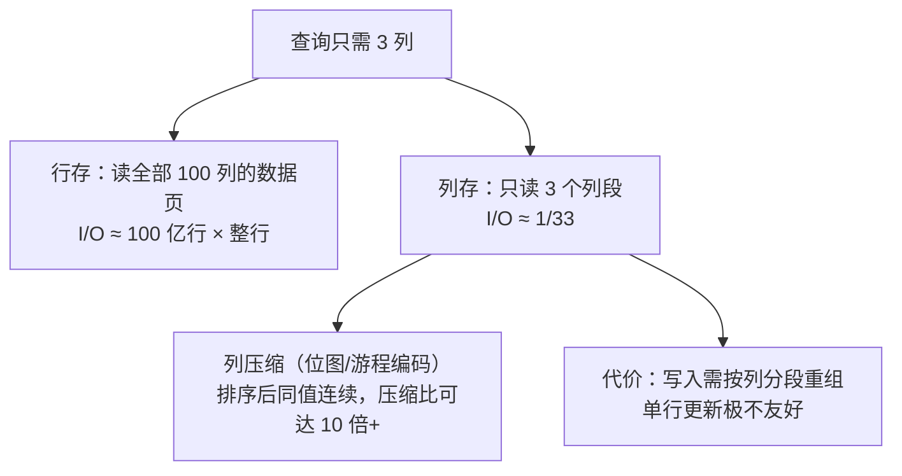

id: P-4.2-01
type: dilemma
chapter: §4.2 存储与检索
title: 列存为什么聚合快？代价是什么？

## 场景
数仓表 100 列、100 亿行。分析查询：
`SELECT user_city, AVG(amount) FROM orders WHERE dt = '2026-10-01' GROUP BY user_city`
只涉及 3 列。

## 你的问题
行存 vs 列存，这个查询的 I/O 量差多少倍？列存为这个优势付出了什么代价？

## 图
列存的读取剪裁与写入代价：

## 揭示
- **I/O 差距**：行存必须把整行读进来才能取 3 列，I/O 放大约 33 倍；
  列存只读 3 个列段，加上压缩后实际可能只有几十分之一到百分之一。
  聚合查询是列存的主场。

- **压缩是二级优势**：列内数据类型相同，排序后同值连续，
  游程编码 + 位图索引能把一列压到极小。
  压缩后的数据甚至可以直接在压缩态上做聚合（向量化执行），连解压都省了。

- **代价（你可能没想到的）**：列存写一行 = 写 100 个列段，
  单行更新更是灾难。所以列存数仓普遍**不追求单行实时写**，
  而是批量导入 + 后台合并。这就是为什么 OLTP 库几乎不用列存——
  不是技术不行，是写入形状完全不符。

- **易混淆点**：宽列数据库（Bigtable/HBase）名字里有"列"但其实是行存，
  同一行的值存放在一起。判断标准看**同一列的值是否物理相邻**。

## 自测
- 单选: 列存查询只涉及 3 列时，相比行存 I/O 优势的主要来源是？ | CPU 更快 | 只读需要的列段且列压缩后更小* | 索引更多 | 数据更小
- 判断: HBase 这类宽列数据库和列式存储是同一类东西。 [错]

## 原文关联
- [§4.2 列式存储](/ch4/#sec_storage_column)
- [§4.2 列压缩](/ch4/#sec_storage_column_compression)
- [§4.2 物化视图与多维数据集](/ch4/#sec_storage_materialized_views)
