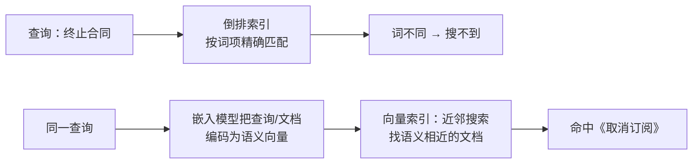

id: P-4.3-01
type: dilemma
chapter: §4.3 存储与检索
title: 语义搜索："关闭账户"要能搜到"取消订阅"

## 场景
帮助中心搜索。传统全文检索（倒排索引）下，用户搜"终止合同"
搜不到标题为"取消订阅"的文章——词完全不同。

## 你的问题
倒排索引为什么做不到？语义搜索的思路和代价是什么？

## 图
关键词检索与语义检索的机制差异：

## 揭示
- **倒排索引的本质限制**：它只能匹配"出现过这个词"的文档，
  同义改写、意图相近但用词不同，天然失明。
- **语义搜索**：嵌入模型把文档和查询都编码成高维浮点向量，
  语义相近 → 向量距离近。检索变成"找最近邻"，
  由专门的向量索引（近似最近邻算法）支撑。
- **代价（你可能没想到的）**：
  - 近似算法为了速度会**牺牲召回的精确性**——偶尔漏掉真正最近的；
  - 嵌入模型的质量决定了上限，且换模型 = 全量重新嵌入所有文档；
  - 向量检索通常不解释"为什么像"，调试体验远不如倒排索引的关键词命中。
- **工程正解常是混合**：倒排索引保精确召回（型号、错误码），
  语义检索补意图匹配，两路合并。

## 自测
- 单选: 倒排索引搜不到"取消订阅"（查询为"终止合同"）的根本原因是什么？ | 索引太小 | 只匹配词项出现与否，不理解语义* | 分词错误 | 文档没被收录
- 判断: 向量近邻搜索总是返回数学上精确的最近邻。 [错]

## 原文关联
- [§4.3 全文检索](/ch4/#sec_storage_full_text)
- [§4.3 向量嵌入](/ch4/#id92)
