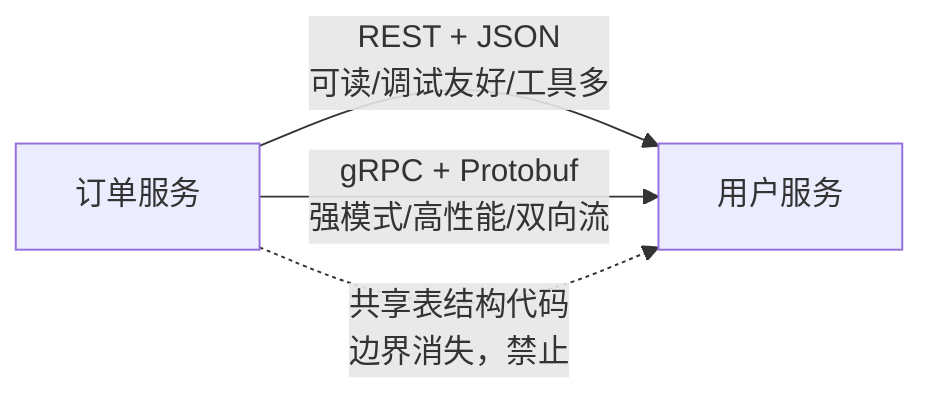

id: P-5.1-02
type: dilemma
chapter: §5.2 编码与演化
title: REST 还是 RPC：内部服务间怎么通信？

## 场景
微服务架构，订单服务要调用户服务。团队争论：
A 说统一 REST + JSON；B 说用 gRPC（Protobuf）；
C 说既然都在同一个公司，直接共享用户服务的数据库表结构代码。

## 你的问题
三种方案的核心差异是什么？"共享代码/表结构"为什么被普遍认为是坑？

## 图
编码格式与服务边界的匹配：

## 揭示
- **REST + JSON**：无模式约束但生态和调试性最好。
  适合对外 API 和变化频繁的内部接口。
- **gRPC**：Protobuf 强模式让"接口变更破坏兼容"在编译期暴露，
  多路复用和双向流性能好。适合内部高频调用。
- **共享数据库表结构（你可能没想到为什么它是坑）**：
  它把数据编码格式和服务边界同时焊死——
  任何一方改表结构（哪怕加一列），所有使用方都要重新部署。
  这正是第 5 章核心论点的反面教材：**数据流经服务边界时，
  必须允许两侧独立演化，而独立演化的前提是"模式化的、兼容的编码"**。
- **选择依据不是新旧，而是**：调用是否需要强模式约束和低延迟（gRPC），
  还是调试友好和普适接入（REST）。两者共存是常态。

## 自测
- 判断: 内部微服务间直接共享数据库表结构是最快且推荐的做法。 [错]
- 单选: gRPC 相比 REST+JSON 的核心优势是什么？ | URL 好看 | 强模式约束 + 高性能多路复用* | 不需要网络 | 天然支持浏览器

## 原文关联
- [§5.2 流经服务的数据流：REST 与 RPC](/ch5/#sec_encoding_dataflow_rpc)
- [§5.2 事件驱动的架构](/ch5/#sec_encoding_dataflow_msg)
