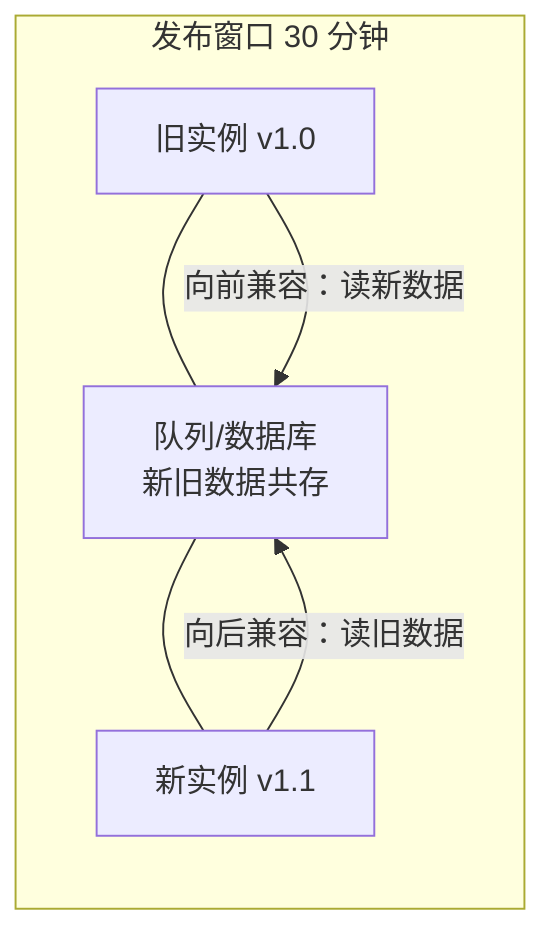

id: P-5.2-01
type: dilemma
chapter: §5.2 编码与演化
title: 服务升级期间，新旧版本并存怎么办？

## 场景
你的服务有 50 个实例，滚动发布新版本。发布要 30 分钟，
期间新旧实例并存。消息队列里还有昨天发出、还没消费的旧格式消息。

## 你的问题
新代码要能读旧格式，旧代码可能还要读新格式——
这分别叫什么兼容性？哪些编码格式能做到？先想再看。

## 图
滚动发布期的双向兼容要求：

## 揭示
- **向后兼容**（新代码读旧数据）：必须满足，容易做到——
  新代码知道旧格式长什么样。
- **向前兼容**（旧代码读新数据）：容易被忽略！旧实例还在跑，
  它收到新版本写入的数据不能崩。这要求**旧代码遇到未知字段要跳过而不是报错**。

- **格式的能力排序**：
  - 语言内置序列化（Java Serialization）：危险，仅限本语言且安全漏洞多
  - JSON：可读性好，但整数精度、二进制支持弱，无正式模式
  - Protocol Buffers / Avro：有显式模式 + 演化规则
    （新增字段必须给默认值或 optional；字段编号不可复用），
    是跨服务数据流的工程正解。

- **你可能没想到的**：Avro 用"写入者模式与读取者模式分离"解决兼容：
  数据不带字段名（只有编号），读方持有自己的模式定义，
  两侧模式在读取时对齐。这让演化规则可以非常灵活——
  但代价是**你必须保存好历史所有版本的模式**（通常放 Schema Registry）。
  丢掉旧模式文件，旧数据就再也读不出来了。

## 自测
- 判断: 滚动发布期间，旧代码读新数据的能力（向前兼容）可以不要求。 [错]
- 单选: Avro 读取旧数据不依赖字段名而依赖什么？ | 字段顺序 | 字段编号与两侧模式对齐* | JSON key | 固定偏移量

## 原文关联
- [§5.2 数据流的模式](/ch5/#sec_encoding_dataflow)
- [§5.1 Avro](/ch5/#sec_encoding_avro)
- [§5.1 写入者模式与读取者模式](/ch5/#the-writers-schema-and-the-readers-schema)
