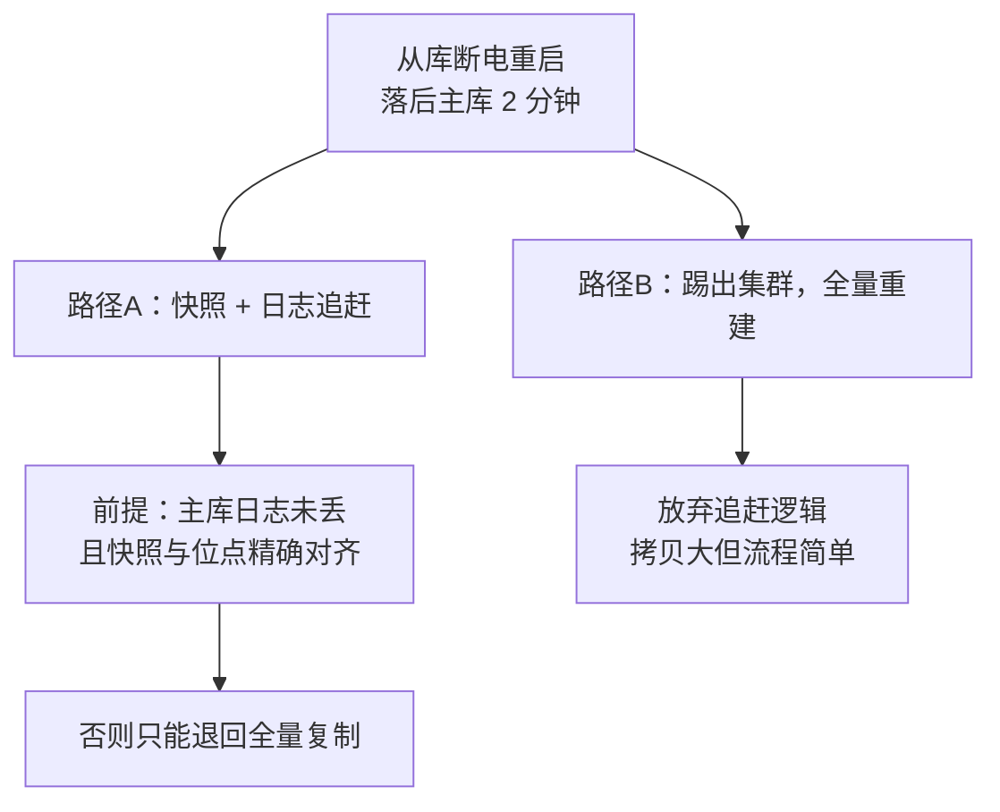

id: P-6.1-01
type: dilemma
chapter: §6.1 复制：领导者与追随者
title: 你的从库挂了，怎么恢复？

## 场景
单主复制，两个异步从库。其中一个从库所在机器突然断电重启，
它本地落后主库约 2 分钟的写入。

约束：不允许停机；主库流量很大，不能让从库长时间脱队。

## 你的问题
重启后的从库怎么追上主库？请先在心里给出你的方案，再往下看。

## 揭示
最直觉的答案"重放主库日志"有个隐藏前提：主库日志不能丢。
于是真正的权衡是——

- **从主库快照 + 日志恢复**（标准做法）：
  从库取主库某个时间点的快照，再请求快照点之后的所有变更日志重放。
  代价：快照必须与日志位点精确对齐，主库要保留足够长的日志，
  否则从库要整体重新全量复制。

- **你可能没想到的第三种**：干脆不做增量追赶，直接把这台从库
  踢出集群，用新机器全量重建。流量大时这反而更快、更不易出错，
  很多大型运维体系就是这么做的——追赶逻辑的复杂度不值得省那点拷贝。

## 图
两条追赶路径：

## 记住这一句
> 追赶机制的正确性取决于"日志不丢"这个前提，运维上常用"全量重建"回避它。

## 自测
- 判断: 从库断电重启后，只要主库日志还在，就一定能通过重放日志追上主库。 [错]
- 单选: 从库追赶的"快照+日志"方案中，最容易出现问题的环节是什么？ | 主库日志保留时间不够，快照位点之前的日志已被清理* | 从库磁盘太小 | 网络带宽不足 | 快照文件太大

## 原文关联
- [§6.1 设置新的副本](/ch6/#sec_replication_new_replica)
