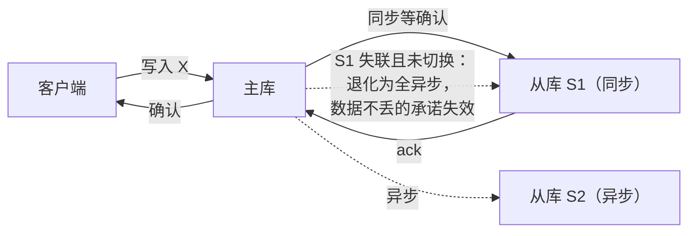

id: P-6.1-02
type: dilemma
chapter: §6.1 复制：领导者与追随者
title: 同步复制到几个副本？

## 场景
你要为一个支付系统设计复制：1 主 + 2 从。
老板要求"任何已确认的写入都不能因为单机故障而丢失"。

## 你的问题
从库的复制你选全异步、全同步，还是半同步？各自的代价是什么？
请先选一个并说出理由。

## 揭示
- **全异步**：主库确认写入不等从库，主库一崩，还没复制出去的写入全部丢失。
  直接违反需求，排除。

- **全同步（2 个从库都确认）**：任一从库故障，主库就无法写入任何东西。
  你为了防一台机器挂，让自己系统在三台机器任一挂掉时整体不可写。

- **半同步**：主库只需等**一个**从库确认。一台从库挂，写入继续且数据不丢；
  但如果那个同步从库挂了而你不处理，系统会退化成全异步而不自知。
  所以半同步需要故障检测：同步从库失联后要主动把另一个从库提升为同步。

## 图
半同步复制的写入确认路径（以及退化点）：

## 记住这一句
> 半同步是"数据不丢"和"可用性"之间的实际平衡点，但它引入了新问题：退化检测。

## 自测
- 单选: 半同步复制中，同步从库失联而系统未做切换，会发生什么？ | 写入静默退化为全异步，数据不丢的承诺失效* | 写入直接报错 | 从库自动升级为主库 | 数据立即丢失
- 判断: 全同步复制（所有从库确认）比半同步更安全，因此是生产系统推荐的默认选择。 [错]

## 原文关联
- [§6.1 同步复制与异步复制](/ch6/#sec_replication_sync_async)
