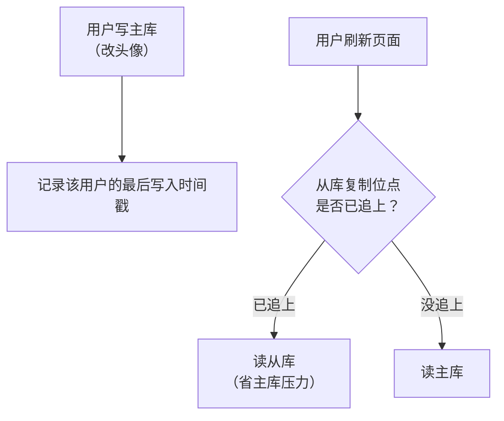

id: P-6.2-01
type: dilemma
chapter: §6.2 复制：复制滞后问题
title: 用户改了自己的头像，刷新却还是旧的

## 场景
你的社交 App 是单主复制 + 多个只读从库，读请求全部走从库以分担压力。
用户投诉：我刚改了头像，刷新页面还是旧头像，但别人看我的新头像没问题。

约束：不能把所有读都打到主库，那会打爆。

## 你的问题
怎么改读路由策略？哪些请求必须走主库，哪些可以走从库？

## 揭示
这是**读己之写**（read-your-writes）问题。朴素方案和它们的坑：

- **"改完之后 N 秒内读主库"**：最常用。坑在于 N 不好定：跨机房复制时
  滞后可能到分钟级；而且"改"不一定发生在你记得的地方
  （改头像是一个入口，用户可能从另一个设备改）。

- **按"用户是否最近改过"路由**：记录每个用户最近写入的时间戳，
  读时对比从库复制位点，位点不够就换主库读或等待。
  精确，但每个请求多一次元数据查询。

- **你可能没想到的维度**：跨设备场景。用户在手机上改、在电脑上看，
  电脑端的请求拿不到手机端的"我改过"状态。
  解法是把最后写入时间戳记在**账户级别**甚至放在客户端请求里带上。

## 图
读路由策略：

## 记住这一句
> "读己之写"的难点不在路由，在"如何知道这次读是'自己刚写过的'"，尤其跨设备。

## 自测
- 判断: "改完之后 N 秒内读主库"是精确可靠的读己之写方案。 [错]
- 单选: 用户在手机上改了资料，在电脑上看不到更新，最可能的原因是什么？ | 电脑端请求走了滞后的从库，且"我改过"标记没跨设备同步* | 电脑网络故障 | 主库宕机 | 数据库索引失效

## 原文关联
- [§6.2 读己之写](/ch6/#sec_replication_ryw)
