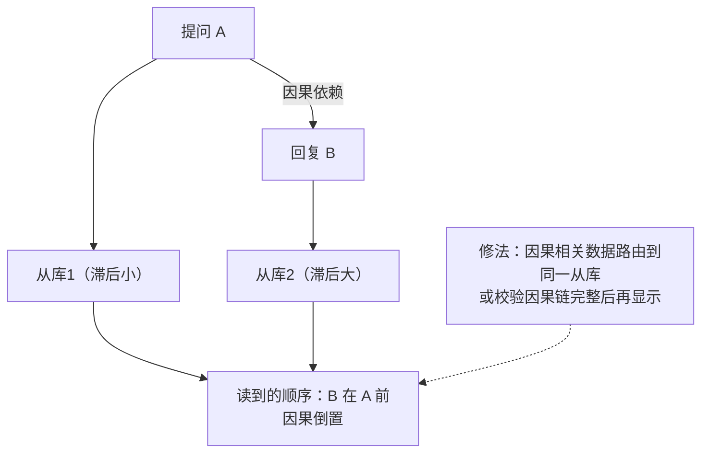

id: P-6.2-02
type: dilemma
chapter: §6.2 复制：复制滞后问题
title: 一条评论的回复出现在了评论前面

## 场景
还是那个多从库的社交 App。某条热门帖子里，用户 A 的提问出现在
列表顶部，但下面 B 的回复因为走了滞后更严重的从库，排序反而靠后，
看起来像"回复先于提问发生"。

约束：评论量大，不可能每条评论都保证全局精确顺序。

## 你的问题
这个"因果倒置"要不要修？修的话修到什么粒度？

## 揭示
这是**单调读**之上的更深问题：**一致前缀读**（consistent prefix read）。
关键认知：不是所有读都需要它——

- **不用修的场景**：互相没有因果关系的两条数据（两条独立动态），
  顺序错无所谓。用户对这种错序几乎无感。

- **该修的判定**：只要存在"后者引用前者"的因果关系（回复引用提问，
  转发引用原帖），倒序就是可感知的荒谬。

- **修法**：让因果相关的写入带上依赖信息，读取时把整条因果链路由到
  同一个从库，或校验链完整后才显示。分区（分片）数据库里这很贵，
  因为不同分片间没有全局顺序。

- **你可能没想到的答案**：很多产品直接在 UI 上规避——热门帖子
  按楼层号排序而不是时间戳排序，楼层号由主库统一分配。
  用产品手段绕开分布式难题，是工程里被低估的选项。

## 图
因果倒置的成因与修法：

## 记住这一句
> 因果倒置只需要在"存在引用关系"的数据上修，且常常可以用产品手段绕开。

## 自测
- 判断: 为了保证正确性，所有评论列表都必须实现一致前缀读。 [错]
- 单选: 以下哪种数据倒序最需要修复？ | 两条互不相关的动态顺序颠倒 | 用户对自己帖子的回复出现在原帖之前* | 广告和帖子的顺序变化 | 点赞数显示略有延迟

## 原文关联
- [§6.2 一致前缀读](/ch6/#sec_replication_consistent_prefix)
- [§6.2 单调读](/ch6/#sec_replication_monotonic_reads)
