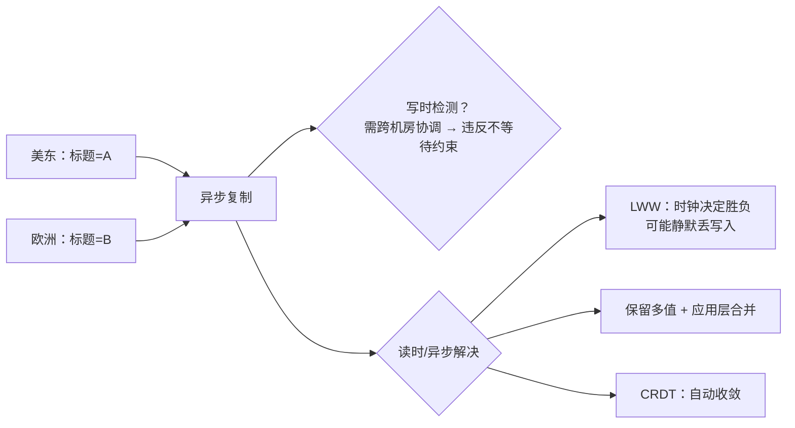

id: P-6.3-01
type: dilemma
chapter: §6.3 复制：多主复制
title: 两个数据中心都能写，冲突来了怎么办？

## 场景
你的协作编辑类产品在美东和欧洲各有一个数据中心，都接受写入、
异步互相同步（多主复制）。两个用户几乎同时把**同一个文档的标题**
改成了不同的值。

约束：不能让任何一端的用户等待另一端数据中心确认。

## 你的问题
这个冲突必须在哪一刻被解决？请给出你认为的解决时机，再往下看。

## 揭示
冲突解决的时机选择比方法选择更根本：

- **写时检测（主库层面同步解决）**：等价于把多主退化成需要协调的写入，
  违反"不等待另一端"的约束，排除。

- **读时/异步解决**：冲突先共存，之后收敛。这是多主的实际选择。
  剩下的问题才是"怎么收敛"：

  - **LWW（最后写入者胜）**：最简单，但"最后"由时钟决定，
    时钟偏移会静默丢弃某一方的写入。标题这种字段也许可接受，
    购物车删条目绝不可接受。
  - **保留所有值 + 应用层合并**：让用户看到两个版本并选择。
    对协作类产品这反而是体验最好的。
  - **CRDT**：为特定数据结构（计数器、集合、序列）设计的可自动合并
    表示。编辑器场景的行业主流就是 CRDT 或 OT 算法，
    而不是数据库层的通用冲突解决。

## 图
冲突解决的时机与手段：

## 记住这一句
> 多主冲突解决的第一问是"何时解决"（必然是异步），第二问才是"怎么收敛"；且通用方案（LWW）往往不如领域专用方案（CRDT）。

## 自测
- 单选: 多主复制中，冲突解决的时机只能是？ | 写入时同步解决 | 读时或异步解决* | 定时批量解决 | 由用户手动解决
- 判断: LWW 是大多数场景下最可靠的冲突解决方式。 [错]

## 原文关联
- [§6.3 处理写入冲突](/ch6/#sec_replication_write_conflicts)
- [§6.3 CRDT 与操作变换](/ch6/#sec_replication_crdts)
