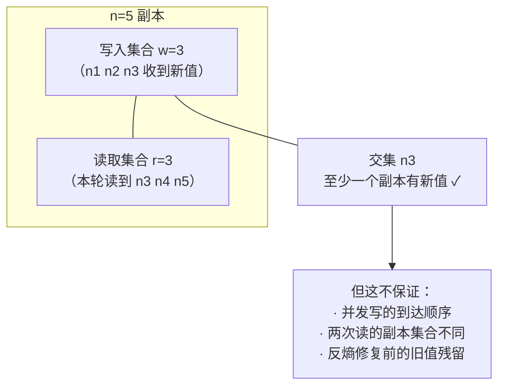

id: P-6.4-01
type: dilemma
chapter: §6.4 复制：无主复制
title: 不选主库了，写入确认几份才安全？

## 场景
你用无主复制（Dynamo 风格）：5 个副本，客户端直接写多个副本，
没有主库。有个后台任务会修复滞后副本（读修复 + 反熵）。

## 你的问题
写确认数 w 和读副本数 r 怎么定？为什么这样定能（或不能）保证读到最新值？
请先写出你选的数字和推理。

## 揭示
核心不等式 **w + r > n**（本例 n=5，比如 w=2, r=4 或 w=3, r=3）：
读写集合必有交集，至少有一个副本持有新值。

但这是全卡最重要的陷阱——**交集只是"必要条件"而非"充分保证"**：

- **并发写没有全序**：两个客户端并发写同一个键，两个集合都会收到
  自己的版本，交集副本拿到的"新值"取决于到达顺序。需要 LWW 或
  版本向量兜底。
- **写与读并发**：读开始后才完成的写，照样读不到。
- **w + r > n 不保证单调读**：两次连续读可能碰到不同的副本集合，
  第一次读到新值、第二次反而读到旧值。
- **反熵是异步的**：一个副本上被丢弃的旧值（LWW 败者）在修复前一直存在，
  如果你恰好像限读它，等式失效。

所以书中说 w + r > n 只能达到**法定人数可读**（quorum readable），
不是强一致。

## 图
w + r > n 的交集保证，以及它为什么不是充分条件：

## 记住这一句
> w + r > n 保证"读到某个足够新的副本"，不保证"读到全局最新、也不保证两次读一致"。

## 自测
- 判断: 只要配置满足 w + r > n，读到的就一定是全局最新的值。 [错]
- 单选: n=5 时，以下哪组配置满足法定人数条件？ | w=2, r=3 | w=3, r=3* | w=1, r=4 | w=2, r=2

## 原文关联
- [§6.4 仲裁一致性的局限](/ch6/#sec_replication_quorum_limitations)
- [§6.4 检测并发写入](/ch6/#sec_replication_concurrent)
