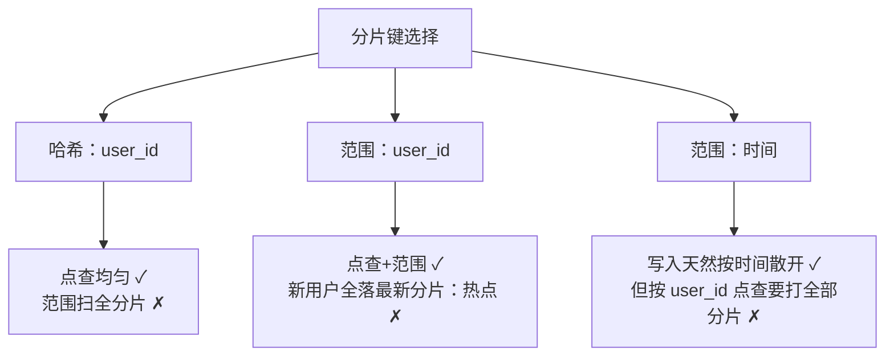

id: P-7.1-01
type: dilemma
chapter: §7.1 分片
title: 用户表按什么键分片？热点与查询的拉锯

## 场景
用户表 10 亿行，单库撑不住了。候选分片键：

- 方案 A：按 user_id 哈希
- 方案 B：按注册时间范围（每月一个分片）
- 方案 C：按 user_id 范围

业务查询：① 按 user_id 点查（最高频）；② 后台要扫全表做数据分析；
③ 注册高峰集中在几分钟（新用户大量涌入）。

## 你的问题
三种方案各在哪个查询上翻车？最终选哪个？

## 图
分片键选择的三难困境：

## 揭示
- **方案 A 是默认正解**：哈希让点查（最高频负载）均匀分布，
  均匀本身就是对热点最好的防御。
- **方案 B 的翻车点**：时间范围分片下，注册高峰 = 单分片写入风暴；
  且历史分片冷（没流量）最新分片烫（全部写入），扩容也救不了。
- **方案 C 的翻车点**：user_id 顺序写入时同样有"最新分片热点"问题；
  但如果 ID 是随机的，方案 C 兼得点查与范围查——**键的随机性决定范围分片是否可行**。
- **你可能没想到的**：查询 ②（全表分析）在任何分片方案下都是"散射-聚合"，
  分片不解决分析负载。正解还是 Part I 的老结论：同步一份到列存数仓。
  分片是为 OLTP 点查/写入发明的，别指望它兼顾一切。

## 自测
- 单选: 按 user_id 范围分片最大的风险是什么？ | 范围查询慢 | 顺序 ID 导致最新分片写入热点* | 无法点查 | 存储浪费
- 判断: 选好分片键后，全表分析查询的伸缩问题也随之解决。 [错]

## 原文关联
- [§7.1 分片的利与弊](/ch7/#sec_sharding_reasons)
- [§7.2 按键的范围分片](/ch7/#sec_sharding_key_range)
- [§7.2 按键的哈希分片](/ch7/#sec_sharding_hash)
