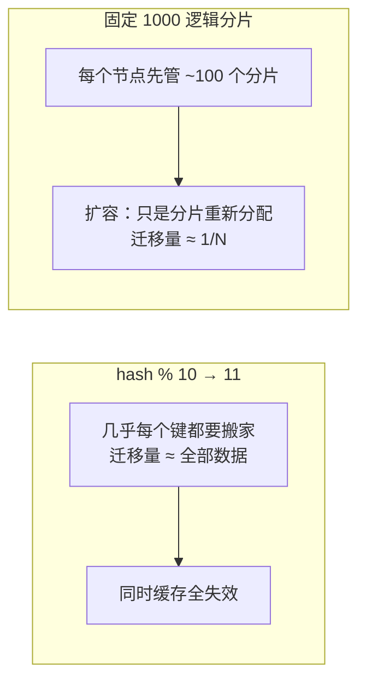

id: P-7.2-01
type: dilemma
chapter: §7.2 分片
title: 扩容要迁移数据：哈希取模为什么是灾难？

## 场景
10 节点集群，分片规则 `hash(key) % 10`。业务增长要扩到 11 节点。

## 你的问题
扩容瞬间会发生什么？固定的分片数（如 1000 个逻辑分片）怎么解决这个问题？

## 图
取模扩容 vs 固定分片数的迁移量对比：

## 揭示
- **取模的灾难**：模数从 10 变 11，绝大多数键的落点都变了——
  一次性迁移几乎全部数据，同时所有应用层缓存集体失效，等于重建集群。
- **固定逻辑分片数（正解）**：一开始就切好远多于节点数的分片
  （如 Cassandra 的 vnode、Kafka 的 partition）。
  扩容 = 把一些分片从繁忙节点搬到新节点，迁移量只有 1/N，
  且可以逐个分片慢慢搬，不停服。
- **你可能没想到的**：分片数要**预先留足余量**且之后很难再改——
  逻辑分片数本身就是新的"模数"。1000 是常见起点：
  足够细到能在异构节点间做负载均衡，又不会让元数据管理失控。

## 自测
- 单选: `hash % N` 扩容（N 变化）的根本问题是什么？ | 哈希函数要换 | 几乎全部键落点改变，需迁移几乎全部数据* | 磁盘不够 | 无法点查
- 判断: 逻辑分片数可以在业务增长后随时按需调整。 [错]

## 原文关联
- [§7.2 哈希取模节点数](/ch7/#hash-modulo-number-of-nodes)
- [§7.2 固定数量的分片](/ch7/#fixed-number-of-shards)
- [§7.2 运维：自动/手动再平衡](/ch7/#sec_sharding_operations)
