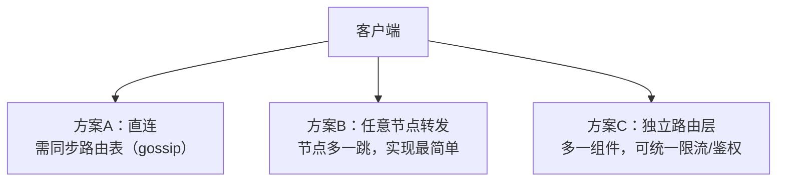

id: P-7.3-01
type: dilemma
chapter: §7.3 分片
title: 请求该发给哪个分片？路由的三种放置

## 场景
客户端要读写某个 user_id。谁来告诉它该找哪个分片？

- 方案 A：客户端自己维护 分片→节点 映射
- 方案 B：随便发给任意节点，节点帮你转发
- 方案 C：经过独立的路由层（协调者/代理）

## 你的问题
三种方案的优劣与失效模式？为什么很多系统选择"请求随便发给谁"？

## 图
路由决策的三种拓扑：

## 揭示
- **这是复杂性放到哪的问题**：A 把复杂性放客户端（要 gossip 协议同步元数据）；
  B 放服务端节点（每个节点都要懂全部路由）；C 放独立组件（多一个要维护和扩容的东西）。
- **你可能没想到的——B 的流行原因**：方案 B 里任何节点都能处理任何请求
  （自己不知道就转发或返回正确节点地址），客户端零路由知识，
  节点故障时客户端完全无感。Cassandra、Riak 都是这个思路。
- **真实风险点在元数据一致性**：无论哪种方案，"节点 ↔ 分片"映射变化时
  （再平衡、故障切换），路由信息短暂的过期是常态。
  系统设计要假设客户端会拿到稍旧的 routing table——
  这又是第 9 章"你对分布式系统的知识总是过期的"的预演。

## 自测
- 单选: "请求发给任意节点，由节点转发"方案的主要优势是什么？ | 延迟最低 | 客户端零路由知识，实现最简单* | 不需要分片 | 天然强一致
- 判断: 使用独立路由层后，路由元数据过期的问题就消失了。 [错]

## 原文关联
- [§7.3 请求路由](/ch7/#sec_sharding_routing)
