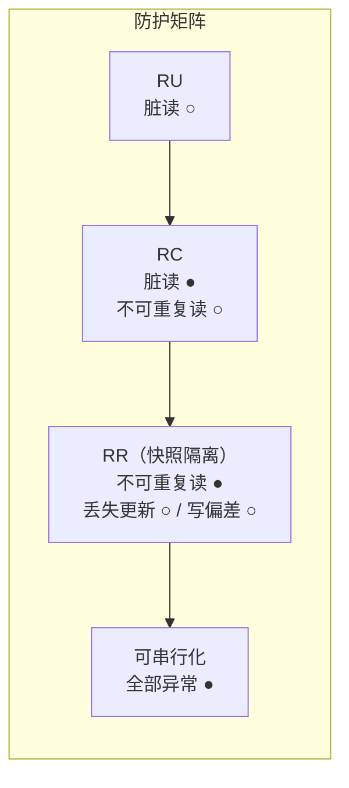

id: P-8.2-01
type: dilemma
chapter: §8 事务（四种隔离级别总览）
title: 你要为这三种业务各选哪个隔离级别？

## 场景
同一个数据库实例上跑三种业务：

1. **报表统计**：凌晨跑一次全表聚合，算用户的总消费额
2. **秒杀扣库存**：高并发下 `SELECT 剩余库存` 然后 `UPDATE 库存 - 1`
3. **余额查询页面**：用户随时打开，看一眼自己的余额

约束：性能要尽可能好，不为不需要的保证付钱。

## 你的问题
三种业务各选哪个隔离级别：读未提交（RU）/ 读已提交（RC）/
可重复读（RR）/ 可串行化（S）？请先给三个答案和理由。

## 揭示
- **报表统计 → RC（甚至 RR）**：它读的是快照，不涉及并发写冲突，
  关键是别读到"写了一半的事务"（脏读）。RU 省不了多少性能
  还会看到未提交数据，没有任何理由选它。
  这就是为什么 **RU 在实践中几乎没人用**——它唯一"优势"是省一点
  读检查开销，代价是正确性。

- **秒杀扣库存 → 看起来 RR 就够，其实是陷阱**：RR 防止你两次
  `SELECT` 读到不同库存，但**它不防止两个事务同时读到"剩 1 个"
  然后都扣减成功**——卖超了。这是丢失更新（lost update），
  需要 `SELECT ... FOR UPDATE`（显式加锁）或原子
  `UPDATE ... SET stock = stock - 1 WHERE stock > 0` 绕过。
  换 S 级别也能防，但高并发下代价大；工程主流是 RC/RR + 原子写。

- **余额查询 → RC 足矣**：单行读，RC 保证不读脏数据就够了。

## 图
各隔离级别防哪些异常（●防护 / ○不防）：

## 记住这一句
> 隔离级别的选择不是"越高越好"，而是"哪些异常你可能遇到"；而最常见的坑是：RR 挡不住丢失更新。

## 自测
- 单选: 以下哪个异常是 RR（快照隔离）无法防止的？ | 脏读 | 不可重复读 | 丢失更新* | 读到未提交数据
- 判断: 隔离级别越高越好，生产系统应默认使用可串行化。 [错]

## 原文关联
- [§8.2 弱隔离级别](/ch8/#sec_transactions_isolation_levels)
- [§8.2 快照隔离与可重复读](/ch8/#sec_transactions_snapshot_isolation)
