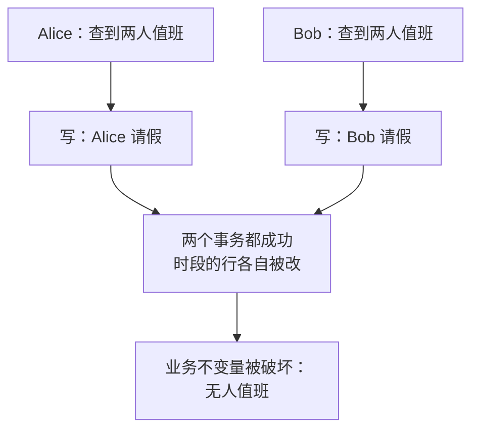

id: P-8.3-01
type: dilemma
chapter: §8 事务
title: 值班医生系统：两个都撤销了自己的班

## 场景
医院值班系统。规则：**同一时段必须至少有一名医生在值班**。
医生可以先查询自己是否值班，不是的话可提交"请假"事务。

现在：Alice 和 Bob 都在值班。两人几乎同时各自打开页面，
都看到"对方在值班"，于是都提交了请假事务。

两个事务都成功。时段内没有任何医生值班。

## 你的问题
这个场景在 RC 和 RR 隔离级别下分别会被阻止吗？
如果不被阻止，你用什么手段阻止？请先想，再看揭示。

## 揭示
**RC 和 RR 都不会阻止它**。这是**写偏差（write skew）**：
两个事务读了同一批数据（"谁在值班"），基于读到的结果写了
**不同的行**（Alice 请假、Bob 请假）。互不修改对方的行，
快照隔离（RR）管不到它。

为什么快照隔离挡不住？因为它承诺的是"每个事务的读来自一致快照"
——两个事务各自看快照都没问题，合起来却违反了业务不变量
（"至少一人值班"）。

**可选的解法**：

- **`SELECT ... FOR UPDATE` 显式锁定**"值班中的所有医生"这些行，
  强制两个事务串行化。最直接，但要求你**知道该锁哪些行**。
- **物化冲突（materializing conflicts）**：把"值班时段"本身
  变成数据库里的行（时_slots 表），请假 = 更新该行，
  冲突就落在同一行上了。丑但有效。
- **可串行化隔离（SSI）**：数据库检测到两个事务读了互相影响的数据
  并发写，中止其中一个。代价是冲突率高时中止率也高。

## 图
写偏差：读同一批、写不同行：

## 记住这一句
> 写偏差 = "我读到的别改，我改的你别读"，快照隔离对它无能为力，这是升级到 SSI 的主要理由。

## 自测
- 单选: 写偏差（write skew）的特征是？ | 两个事务写同一行，后者覆盖前者 | 两个事务读同一批数据、写不同的行，合起来违反业务不变量* | 读到未提交数据 | 两次读结果不同
- 判断: 快照隔离（RR）能防止写偏差。 [错]

## 原文关联
- [§8.2 写偏差与幻读](/ch8/#sec_transactions_write_skew)
- [§8.3 可串行化快照隔离（SSI）](/ch8/#sec_transactions_ssi)
