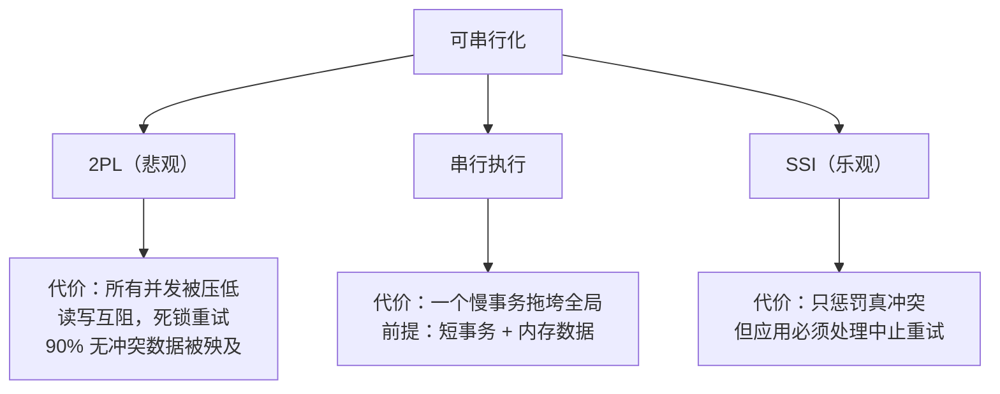

id: P-8.3-02
type: dilemma
chapter: §8 事务
title: 可串行化真的可以"免费"拿到吗？

## 场景
你的团队在评审数据库选型。有人提议："直接全用可串行化（Serializable），
正确性问题一劳永逸，不用再操心各种异常。" 反对者说性能不可接受。

约束：系统读写混合，冲突集中在 10% 的热点账户上，其余 90% 数据
几乎无并发冲突。

## 你的问题
"全用 Serializable"的真实代价是什么？有没有办法只在对的地方付这个代价？

## 揭示
可串行化的三种实现，代价结构完全不同——这是选型的真正依据：

- **两阶段锁定（2PL，传统 S lock）**：读也加锁、写也加锁。
  代价是**所有**并发被压低：读会阻塞写、写会阻塞读，
  90% 无冲突的数据也被殃及，还可能死锁需要重试。
  "全用 S"在 2PL 下确实很贵。

- **串行执行（单线程，如 VoltDB）**：所有事务排队执行。
  极快的前提是**每个事务很短、数据能放进内存**。
  一个慢查询就拖垮整个系统吞吐。适合特定架构，不是通用答案。

- **SSI（可串行化快照隔离，PostgreSQL/CockroachDB 的选择）**：
  乐观策略——先放行，提交时检测读写冲突再中止。
  **无冲突的事务（你的 90%）几乎零开销**，
  冲突集中处中止率升高、需要应用层重试。

所以反对者对了一半：2PL 时代"全 S"确实贵；
SSI 时代"全 S"对低冲突负载是可负担的——但**必须配套重试逻辑**，
应用要习惯"事务可能被中止，请再来一次"。

## 图
三种实现的代价落点：

## 记住这一句
> 可串行化的代价取决于它的实现：2PL 压低一切并发，单线程要求短事务，SSI 只惩罚真冲突但要求应用会重试。

## 自测
- 单选: SSI 的主要代价是什么？ | 所有读写互相阻塞 | 冲突集中处中止率升高，应用必须实现重试* | 只支持内存数据 | 只支持单表
- 判断: SSI 下无冲突的事务几乎零额外开销。 [对]

## 原文关联
- [§8.3 可串行化](/ch8/#sec_transactions_serializability)
- [§8.3 两阶段锁定（2PL）](/ch8/#sec_transactions_2pl)
