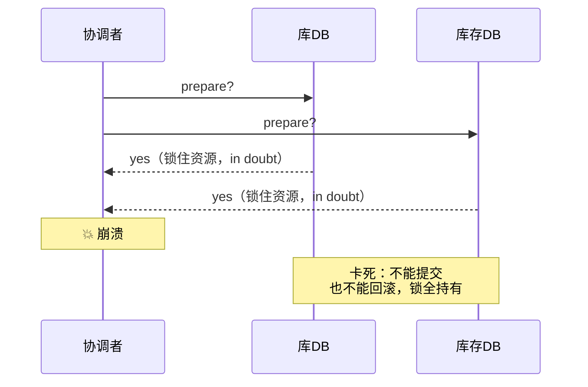

id: P-8.4-01
type: dilemma
chapter: §8.4 事务
title: 两阶段提交卡在"中间态"：协调者挂了怎么办？

## 场景
跨两个数据库的订单+库存扣减，用 2PC 保证原子提交。
流程：协调者问所有参与者"能提交吗"→ 参与者答"能"→ 协调者发"提交"。

参与者答"能"之后、协调者发"提交"之前，协调者进程崩溃。

## 你的问题
此刻参与者处于什么状态？它能单方面提交或回滚吗？为什么 2PC 被叫作"阻塞协议"？

## 图
2PC 的致命等待：

## 揭示
- **参与者进入了 "in doubt" 悬置状态**：它已经承诺"能提交"（承诺不可撤回，
  撤回会破坏原子性），但没等到最终指令。它**既不能提交（可能别的参与者收到的是回滚），
  也不能回滚（可能协调者已经决定提交）**——只能干等并持有全部锁。
- **这就是 2PC 的本质缺陷（你可能没想到的）**：协调者用**一条日志决定全局**，
  但它自己是单点。协调者的故障窗口 = 全部参与者的阻塞窗口。
  三阶段提交（3PC）试图缓解，却引入了网络分区下的不一致风险，业界基本弃用。
- **出路是共识**：把"要不要提交"交给共识协议裁决（Raft/Paxos 化的协调者，
  或直接用 Percolator/TiDB 这类基于共识的事务模型）。
  这正是第 8 章通向第 10 章的桥：**原子提交问题的正解就是共识**。

## 自测
- 单选: 2PC 中参与者答复 yes 后协调者崩溃，参与者能做什么？ | 立即提交 | 立即回滚 | 只能悬置等待，持有锁* | 忽略事务
- 判断: 3PC 解决了 2PC 的所有问题，是现代系统的主流选择。 [错]

## 原文关联
- [§8.4 两阶段提交（2PC）](/ch8/#sec_transactions_2pc)
- [§8.4 协调者失效](/ch8/#coordinator-failure)
- [§8.4 跨不同系统的分布式事务](/ch8/#sec_transactions_xa)
