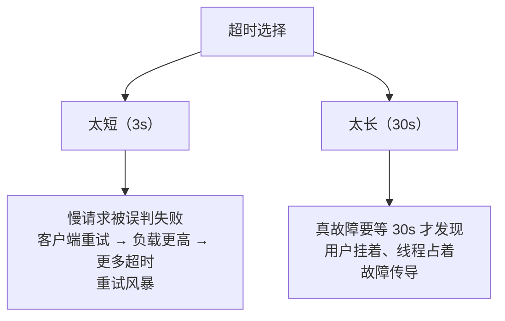

id: P-9.1-01
type: dilemma
chapter: §9.1 分布式
title: 超时该设多长？设错了两边都输

## 场景
服务 A 调服务 B。B 正常处理 50ms，但 GC 偶尔停顿 2s。
你设超时 3s。

某天 B 部署到了另一个机房，网络 p99 抖到 3.5s。

## 你的问题
超时 3s 现在会造成什么后果？设成 30s 又会怎样？有没有系统性的设法？

## 图
超时设短 vs 设长的失败模式：

## 揭示
- **超时不是配置，是判断"对方是否还活着"的唯一手段**——
  而网络不提供任何"还在处理中"的确认。这就是第 9 章核心困境：
  超时 = 用猜测代替事实。
- **太短的重试风暴**：B 只是慢，A 全部超时重试，B 的负载瞬间翻倍，
  慢变成瘫。**正解是重试要带退避 + 抖动，且设重试预算**（如最多 10% 请求可重试）。
- **太长的资源泄露**：等待期间 A 的线程/连接被占用，
  上游也跟着等，一个慢节点拖垮整条调用链（级联失败）。
- **系统性设法（你可能没想到的）**：不用固定超时，用**尾延迟数据动态设**：
  比如 p99.9 × 裕量，并且**取消不再需要的请求**（context 传播），
  让被你放弃的请求别再白耗 B 的资源。

## 自测
- 单选: 服务端只是变慢（没宕机）时，超时设太短最容易引发什么？ | 数据丢失 | 重试风暴使负载翻倍，慢变瘫* | 磁盘满 | 无法部署
- 判断: 超时时间越长，系统整体可用性一定越好。 [错]

## 原文关联
- [§9.2 实践中的网络故障](/ch9/#sec_distributed_network_faults)
- [§9.2 网络拥塞与排队](/ch9/#network-congestion-and-queueing)
