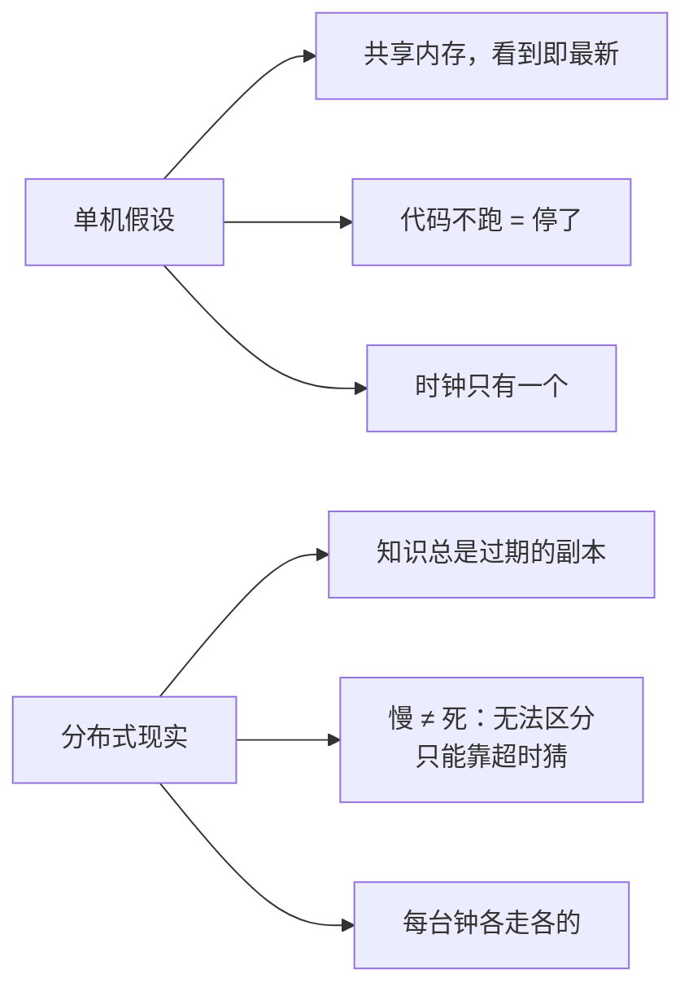

id: P-9.1-02
type: dilemma
chapter: §9.1 分布式
title: 单机 → 分布式：什么直觉失效了？

## 场景
团队把单机服务拆成分布式集群后，连续踩坑：

1. 同一秒内两个节点都认为自己是主（各自本地判断"主挂了"）
2. 单元测试全绿，上线后偶发数据不一致
3. "这个操作是原子的"在单机成立，集群里不成立

## 你的问题
单机编程的哪些默认假设在分布式里失效？为什么不能"把网络做成可靠"来挽救？

## 图
单机假设 → 分布式现实的对照：

## 揭示
- **三大失效假设**：
  ① **共享内存消失**：每个节点只有本地视角，其他节点的状态全是"最近听说的"；
  ② **"没响应 = 挂了"不成立**：网络丢了包 ≠ 对端死了。
  你给节点发消息，收到回复前它可能死了、可能活着、可能活一会儿再死——
  **这个不确定性无法靠协议消除**，只能用超时做有误差的猜测；
  ③ **没有统一时钟**：跨节点的"先后"不能靠时间戳。
- **为什么不能造可靠网络**：网络故障源于光纤断、交换机重启、
  拥塞丢包、拓扑变化——这些是物理和运维现实，不是工程疏忽。
  即使做成"同步网络"（固定时延），也要付出容量锐减的代价，
  而且节点暂停（GC）依然能伪造"网络慢"。**正确的路径不是消灭不确定性，
  而是设计能在不确定性下仍然正确的算法**——这正是 ch9→ch10 的主线。

## 自测
- 单选: 分布式系统中，节点无响应时你能确定什么？ | 它一定挂了 | 它活着 | 无法区分"挂了"和"慢/网络分区"，只能超时猜测* | 网络一定断了
- 判断: 把网络做成足够可靠，单机编程模型就能直接搬到分布式。 [错]

## 原文关联
- [§9.1 故障与部分失效](/ch9/#sec_distributed_partial_failure)
- [§9.2 不可靠的网络](/ch9/#sec_distributed_networks)
- [§9.2 我们不能简单地让网络延迟可预测吗？](/ch9/#can-we-not-simply-make-network-delays-predictable)
