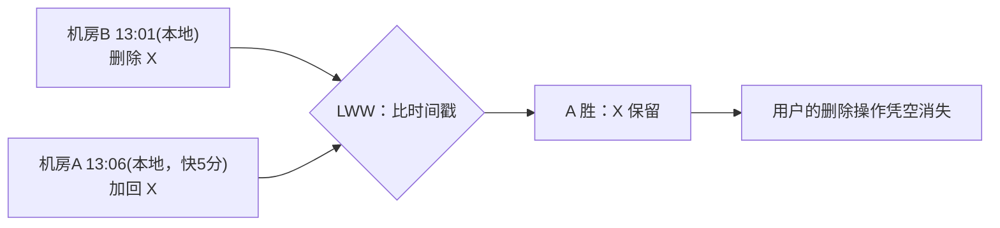

id: P-9.2-01
type: dilemma
chapter: §9.2 分布式
title: 用本地时钟判断"谁先发生"，翻车了

## 场景
双机房写入同一购物车（多主），用**服务器本地时间戳**做冲突解决：
时间戳新者胜（LWW，最后写入者胜）。

机房 A 的时钟快了 5 分钟（NTP 漂移未修正）。

用户操作：13:00 在机房 B 删除了购物车里的商品 X；
13:01 在机房 A 又把 X 加回（其实是想改数量）。

## 你的问题
LWW 会怎么裁决？最终用户看到什么？这个结果错在哪？

## 图
LWW 被时钟误差劫持：

## 揭示
- **裁决被时钟误差劫持**：A 的时钟快 5 分钟，13:01 的操作拿到 13:06 的假时间戳，
  毫无悬念地赢了 13:01 的真实删除。用户视角：**我的删除凭空消失**。
- **更根本的问题（你可能没想到的）**：即使时钟完美，LWW 也在**故意丢弃并发写入**——
  两个"同时"的写只留一个。时间戳排序本质是给并发操作强行编造一个假的全序。
  更糟：LWW 下一个先写入的数据，可能被后同步到的旧值覆盖后**永久丢失**，
  且无人察觉（写后写违反）。
- **工程正解方向**：不要用墙上时钟做因果判断——
  用逻辑时钟（Lamport 时钟、版本向量）保留"谁影响谁"的信息，
  检测到真冲突时交给应用合并（或 CRDT 自动合并）。墙上时钟只该用于测量经过时间。

## 自测
- 单选: LWW 冲突解决的根本缺陷是什么？ | 时间戳太长 | 依赖可能漂移的本地时钟，且故意丢弃并发写* | 存储开销 | 网络延迟
- 判断: 只要所有服务器 NTP 同步良好，LWW 就能安全保留所有写入。 [错]

## 原文关联
- [§9.3 对同步时钟的依赖](/ch9/#sec_distributed_clocks_relying)
- [§9.3 用于事件排序的时间戳](/ch9/#sec_distributed_lww)
- [§9.3 带置信区间的时钟读数](/ch9/#clock-readings-with-a-confidence-interval)
