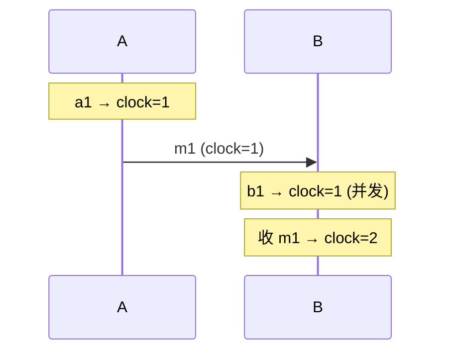

id: S-10.2-01
type: simulation
chapter: §10.2 一致性与共识
title: 推演：Lamport 时钟怎么给并发事件排序

## 推演序列

**系统**：两个节点 A、B，各自维护计数器（Lamport 时钟），规则：
本地事件计数器 +1；发消息携带计数器；收消息取 max(本地, 消息) + 1。

**步骤 1**：A 本地事件 a1。A 的时钟？

**步骤 2**：A 发消息 m1 给 B（时钟随行）。A、B 时钟各多少？

**步骤 3**：B 同时（并发地）做本地事件 b1，然后收到 m1。B 的时钟？

**步骤 4**：全系统需要给事件排序，b1 和 a1 谁先？这个"先"是什么意义上的先？

## 揭示

**步骤 1**：a1 → A = 1。

**步骤 2**：m1 携带 A=1 到达。A 发送后 = 2（按实现，发消息也 +1）。

**步骤 3**：b1 是 B 的本地事件，B = 1。收到 m1：
max(B本地=1, 消息携带=1) + 1 = 2。

**步骤 4**：**Lamport 时钟保证：若 a → b（a 因果上先于 b），则 C(a) < C(b)**。
但 b1 和 a1 是**并发**事件（互相不知道），时钟值相同并不区分先后——
算法用**打破平局规则**（如节点 ID 排序）给它们一个确定的全序。
关键认知：**这个"先"是人为约定的全序，不对应真实物理时间，
但只要所有节点遵守同一规则，全序复制状态机就有了理论基础**——
这正是共识协议（如 Raft 的 log index）排序请求的思想雏形。

## 图
Lamport 时钟的因果传递：

## 自测
- 单选: 两个并发事件的 Lamport 时钟值相同（或需平局规则），说明什么？ | 物理上同时发生 | 它们无因果关系，先后由约定规则确定* | 有 bug | 时钟坏了
- 判断: Lamport 时钟保证：C(a) < C(b) 意味着 a 因果先于 b。 [错]

## 原文关联
- [§10.2 逻辑时钟](/ch10/#sec_consistency_timestamps)
- [§10.2 Lamport 时间戳](/ch10/#lamport-timestamps)
- [§10.2 Lamport/混合逻辑时钟 vs. 向量时钟](/ch10/#lamporthybrid-logical-clocks-vs-vector-clocks)
