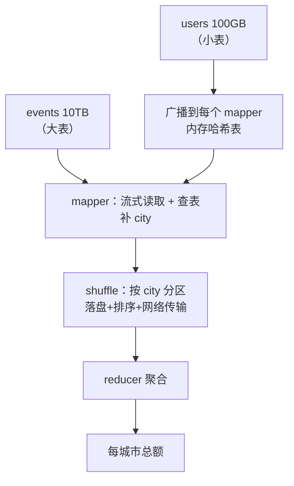

id: S-11.3-01
type: simulation
chapter: §11.3 批处理
title: 推演：一次 JOIN 在 MapReduce 里怎么变成 shuffle

## 推演序列

**系统**：电商事件日志表 events（10TB，按天分区）与用户表 users（100GB），
要算"每个城市的订单总额"。用 MapReduce 实现。

**步骤 1**：这两张表怎么放入 mapper？大表小表待遇一样吗？

**步骤 2**：mapper 输出什么？key 是什么？

**步骤 3**：reducer 拿到数据前，中间发生了什么？

**步骤 4**：为什么说 shuffle 是 MapReduce 的性能命门？

## 揭示

**步骤 1**：**不对称**。users 只有 100GB，可以整体加载进每个 mapper 的
内存/本地（"广播哈希连接"）；events 10TB 按块分给各 mapper 流式处理。
如果两张表都大（TB 级），就要靠 **shuffle 端连接**（相同 key 的记录
被分到同一 reducer）——代价大得多。

**步骤 2**：mapper 读 events 记录，查本地 users 副本拿到 city，
输出 `(city, amount)`；或输出 `(user_id, event)` 交给下游连接。

**步骤 3**：**shuffle**：所有 mapper 的输出按 key（city/user_id）分区，
经网络重分布到对应 reducer。这一步要落盘、要排序、要跨网络传输——
**是整个作业唯一强制全局同步的环节**。

**步骤 4**：因为 shuffle 的代价由**数据倾斜**决定。
如果某个 city 占了 30% 的数据（北京、上海），
那一个 reducer 要处理 3TB，其他 reducer 早早完成——
**木桶效应**：作业时长由最慢的 reducer 决定。
解决靠加盐打散热点 key、两阶段聚合。这也是批处理与流处理
共同的核心难题：**分布式的墙是数据倾斜，不是算力**。

## 图
MapReduce JOIN 的两条路径：

## 自测
- 单选: MapReduce 作业里唯一需要全局同步的环节是？ | map 阶段 | shuffle 阶段* | 输出写入 | 作业调度
- 单选: 某个 reducer 处理的数据远超其他 reducer，问题叫什么？ | 背压 | 数据倾斜* | 写放大 | 脑裂

## 原文关联
- [§11.3 MapReduce](/ch11/#sec_batch_mapreduce)
- [§11.3 JOIN 与 GROUP BY](/ch11/#sec_batch_join)
- [§11.3 混洗数据](/ch11/#sec_shuffle)
