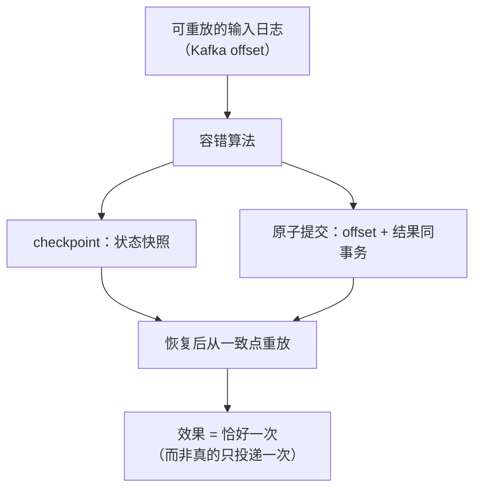

id: S-12.4-01
type: simulation
chapter: §12.4 流处理
title: 推演：流处理如何做到"恰好一次"效果

## 推演序列

**系统**：Kafka 消费者读事件 → 更新状态（累加计数）→ 写出结果。
消费者可能随时崩溃重启。

**步骤 1**：如果消费者每处理一条就提交 offset，崩溃后会丢吗？还会重复吗？

**步骤 2**：如果先处理、后批量提交 offset，崩溃后有什么后果？

**步骤 3**：既然无法避免重复投递，怎么让重复不影响最终结果？

**步骤 4**：把状态也存在内部（RocksDB）而不是外部数据库，又带来什么新问题？

## 揭示

**步骤 1**：**可能丢**。提交了 offset 但结果还没写完（或已写完但下游没收到），
重启后从新 offset 开始，那条数据永远不会被再处理。
→ "最多一次"（at-most-once），丢数据。

**步骤 2**：**可能重复**。处理完了但 offset 没提交，重启后重放，
同一条数据被算两遍。→ "至少一次"（at-least-once），数据正确性受损。

**步骤 3**：**幂等 / 可重放**两条路：
① **幂等写入**：结果表以事件 ID 为主键 upsert，重复处理结果不变；
② **事务性写入**：把 offset 提交与结果写入放进**同一个原子事务**
（Kafka 事务、或 Flink 的 two-phase commit sink），
要么都生效要么都不生效——**这就是"恰好一次"的全部秘密：它不是不重复投递，
而是让重复投递不可见**。

**步骤 4**：状态在内部意味着状态本身也要容错：
靠 **checkpoint**（定期把状态快照到持久存储）+
**从 checkpoint 对应的 offset 重放**输入日志来恢复。
所以"恰好一次"需要一个**可重放的输入日志**作为前提——
这就把流处理的容错和 12.1 的日志模型锁在了一起。

## 图
恰好一次的两个支点：

## 自测
- 单选: 流处理"恰好一次"的实现本质是什么？ | 网络绝不丢包 | 重复投递 + 幂等/原子提交，使重复不可见* | 只投递一次 | 不用 checkpoint
- 单选: 先处理数据、后提交 offset，崩溃重启后果是什么？ | 丢数据 | 重复处理（至少一次）* | 无影响 | 状态损坏

## 原文关联
- [§12.3 容错](/ch12/#sec_stream_fault_tolerance)
- [§12.3 幂等性](/ch12/#sec_stream_idempotence)
- [§12.3 再谈原子提交](/ch12/#sec_stream_atomic_commit)
