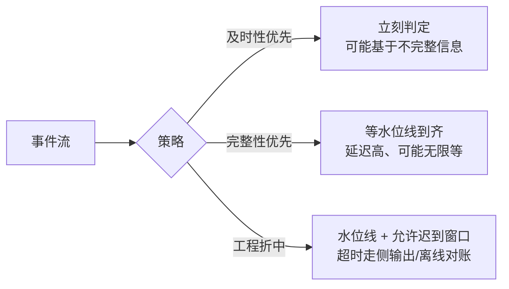

id: S-13.3-01
type: simulation
chapter: §13.3 数据的未来
title: 推演：及时性与完整性，你只能优先一个

## 推演序列

**系统**：事件日志驱动的派生视图系统。
需要判断一个交易是否欺诈，然后决定放行或拦截。

**步骤 1**：如果**只追求及时性**（收到事件立刻判定），
上游某条关键事件还在路上会怎样？

**步骤 2**：如果**只追求完整性**（等所有相关事件到齐再判定），
用户要等多久？业务能接受吗？

**步骤 3**：两个目标能同时满足吗？

**步骤 4**：工程上怎么落地这个权衡？

## 揭示

**步骤 1**：可能做出**错误判定**——基于不完整的信息放行了一笔欺诈。
及时性优先 = 接受错误（假阴性）。

**步骤 2**：可能等很久，甚至**永远等不到**（那个事件可能真的没发生，
或者链路故障）。完整性优先 = 接受延迟（用户等待）。

**步骤 3**：**不能**。这是 DDIA 关于流处理的核心断言：
  及时性（低延迟）与完整性（不遗漏）在**存在不可靠网络**的前提下
  是互斥的——因为"是否还有事件在路上"这个问题，
  正如第 9 章所说，**只能靠猜测（水位线/超时）**。

**步骤 4**：落地方式是把两个目标**变成显式策略**：
  ① 用**水位线**设定"等到什么时候算齐"，用**允许迟到窗口**兜住轻微迟到；
  ② 迟到超过阈值的走**侧输出**，进入人工/离线修正流程；
  ③ 对必须完整的关键指标（如对账），用**批处理重算 + 与流结果比对**（对表）；
  ④ 关键决策（放行/拦截）应用**保守策略**（宁可延迟也不放错）。
  核心认知：**不要试图消灭这个权衡，而要把它变成一个明确的、
  可观测、可调整的产品决策**——含糊地"两者都要"才是最危险的状态。

## 图
及时性与完整性的取舍：

## 自测
- 单选: 及时性与完整性为什么无法同时最优？ | 算力不足 | 因为"是否还有事件在路上"无法被确证，只能猜测* | 存储太贵 | 编程模型限制
- 单选: 对必须保证完整的关键指标，推荐的兜底做法是？ | 无限等待 | 批处理重算并与流结果对表* | 直接丢弃迟到事件 | 提高机器配置

## 原文关联
- [§13.3 及时性与完整性](/ch13/#sec_future_integrity)
- [§13.3 信任但验证](/ch13/#sec_future_verification)
- [§13.2 观察衍生状态](/ch13/#sec_future_observing)
