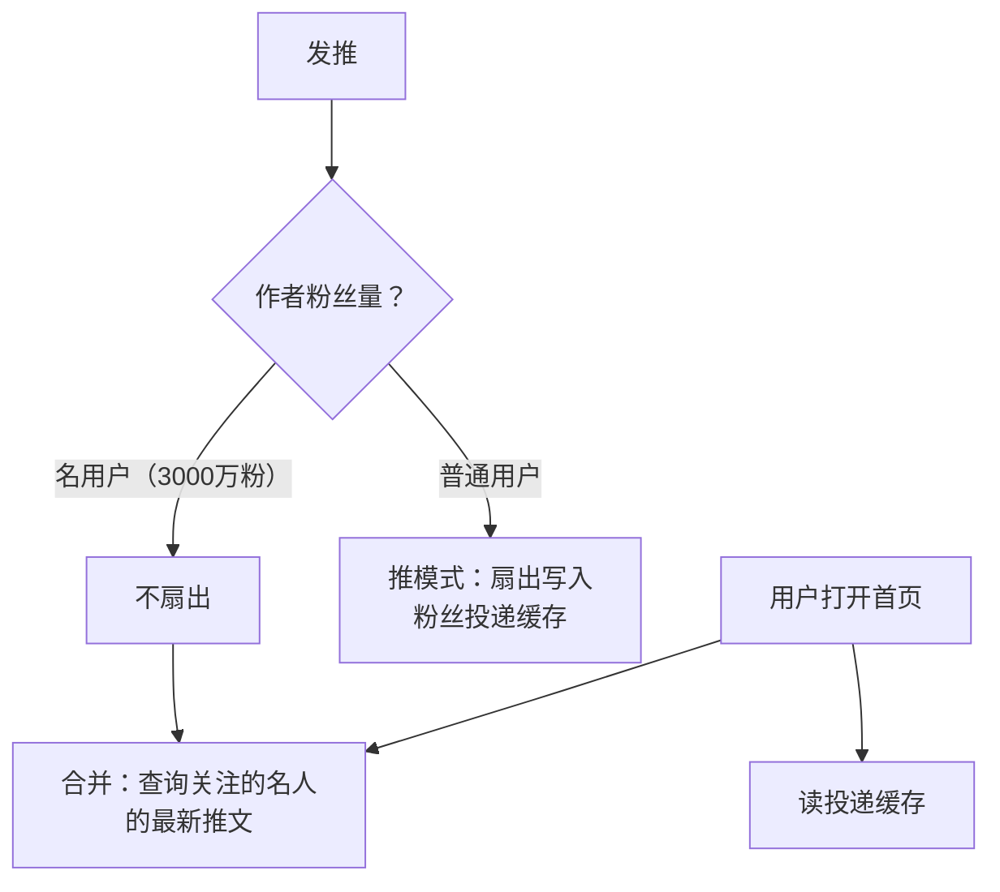

id: S-2.1-01
type: simulation
chapter: §2 定义非功能性需求
title: 推特时间线：为什么"查"比"写"更难扛？

## 推演序列

**系统**：社交网络首页时间线。两种实现方案：

- **方案 A（拉）**：发推只写入作者的发推表。用户打开首页时，
  查自己关注的所有人最近的推文，合并排序。
- **方案 B（推）**：发推时立即写入**每个粉丝**的投递时间线缓存，
  打开首页只查自己的缓存。

**步骤 1**：某名人 3000 万粉丝发一条推，方案 B 会发生什么？

**步骤 2**：普通用户（平均 500 粉丝）发推，方案 B 的成本如何？

**步骤 3**：方案 A 中，一个关注了 2000 人的重度用户打开首页，
代价是什么？

**步骤 4**：选择最终架构。

## 揭示

**步骤 1**：一条推触发 **3000 万次缓存写入**（写放大），
写入风暴，热点键把某个分片打爆。

**步骤 2**：几百次写入，轻松承受。多数用户的推文量占比极高，
平均成本很低。

**步骤 3**：打开首页 = 查询 2000 人的最近推文并合并排序，
每次打开都是一次重查询。重度用户高频打开，代价巨大。

**步骤 4**：**混合方案（推特的实际演进路径）**：
普通用户发推 → 推模式写入粉丝投递缓存（享受低延迟读）；
名用户发推 → 不做扇出，读时单独合并名人推文（读时混合）。
核心认知：**负载形状不均匀时，单一策略必然在最坏情况下崩溃**，
按"扇出代价"给用户分组处理是标准工程手法。

## 图
混合架构：

## 自测
- 单选: 名人发推触发 3000 万次缓存写入，这个问题叫什么？ | 读放大 | 写扇出热点* | 数据倾斜的读 | 合并风暴
- 判断: 推特最终采用纯推模式（发推时写所有粉丝缓存）解决了问题。 [错]

## 原文关联
- [§2.1 案例研究：社交网络首页时间线](/ch2/#sec_introduction_twitter)
- [§2.2 描述性能](/ch2/#sec_introduction_percentiles)
