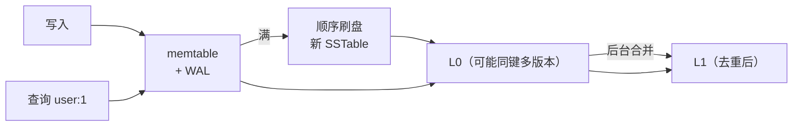

id: S-4.1-01
type: simulation
chapter: §4.1 存储与检索
title: 一次写入在 LSM 树里的完整旅程

## 推演序列（每步先预测再往下看）

**系统**：LSM 树存储引擎，memtable 容量阈值 4 条记录，L0/L1 两层 SSTable。

**步骤 1**：写入 `user:1 = "小明"`。这条数据现在在哪？磁盘上有变化吗？

**步骤 2**：继续写入 user:2、user:3、user:4，memtable 满了。
接下来发生什么？

**步骤 3**：此时查询 `user:1`。查找顺序是怎样的？最坏要查几处？

**步骤 4**：继续写入 `user:1 = "大明"`（同键新值）。
L0 已有旧值，现在查询 user:1 返回什么？靠什么保证？

## 揭示

**步骤 1**：只写内存 memtable + 一条 WAL 日志（防崩溃丢数据）。
磁盘上的 SSTable 没有任何变化——写入是纯内存操作，所以快。

**步骤 2**：memtable 整体刷盘为一个新的 SSTable 文件（不可变），
新 memtable 清空。注意：是**整段顺序写**，没有随机 I/O——
这是 LSM 写吞吐高的根源。

**步骤 3**：先查 memtable（没有）→ L0 最新 SSTable → L0 更旧的 → L1 …
最坏情况：键不存在时要查遍所有层级，直到布隆过滤器告诉你"肯定没有"。
所以 LSM 必须配布隆过滤器，否则空查询代价极高。

**步骤 4**：返回"大明"。**靠"新层级优先 + 层内按时间排序"的规则**：
memtable > L0 新文件 > L0 旧文件 > L1。旧值要等后台合并（compaction）
时才被物理清理。合并期间同一键有多个版本共存，是正常状态而非 bug。

## 图
写入与查询路径：

## 自测
- 判断: LSM 树写入时数据会立即写入磁盘上的 SSTable 文件。 [错]
- 单选: LSM 树查询一个不存在的键，代价靠什么控制？ | 二分查找 | 布隆过滤器* | 更大的 memtable | 更多层级
- 单选: 同一个键在 L0 有旧值、memtable 有新值，查询返回什么？ | 旧值（磁盘优先） | 新值（层级新者优先）* | 随机 | 报冲突错误

## 原文关联
- [§4.1 日志结构存储](/ch4/#sec_storage_log_structured)
- [§4.1 SSTable 文件格式](/ch4/#the-sstable-file-format)
- [§4.1 构建和合并 SSTable](/ch4/#constructing-and-merging-sstables)
