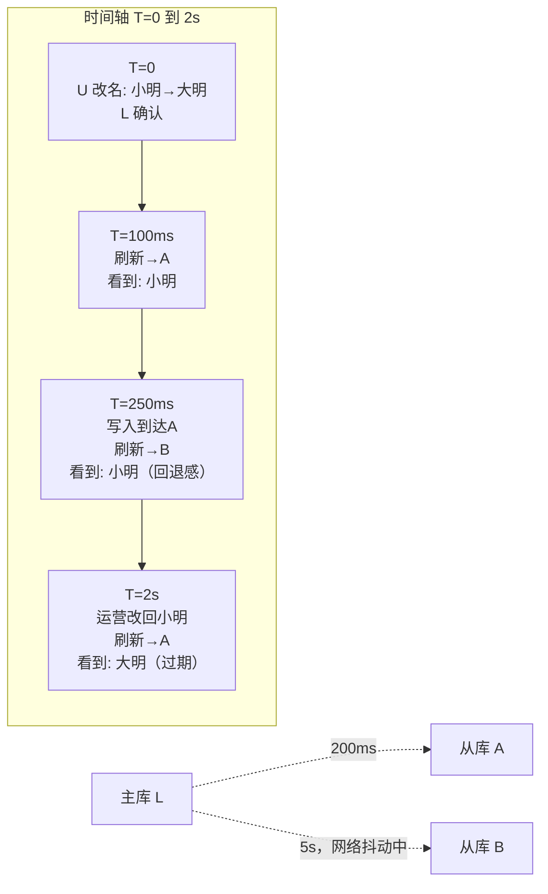

id: S-6.2-01
type: simulation
chapter: §6.2 复制：复制滞后问题
title: 跟踪一条数据在复制滞后期内的真实状态

## 推演序列

**系统**：单主 L + 从库 A（滞后 200ms）+ 从库 B（滞后 5s，正在从网络抖动中恢复）。
时间轴 T=0 起，事件如下：

**步骤 1**：T=0，用户 U 把昵称从"小明"改为"大明"（写入 L，异步复制）。
L 立即向 U 确认成功。

**步骤 2**：T=100ms，U 的刷新请求被负载均衡到从库 A。
→ U 看到的昵称是？（A 的滞后 200ms，此时刻 L 的 T=0 写入尚未到达 A）

**步骤 3**：T=250ms，L 的写入到达 A。U 再次刷新，这次被路由到从库 B。
→ U 看到的昵称是？

**步骤 4**：T=2s，L 的写入仍未到达 B（网络抖动加剧）。
运营同事在后台把 U 的昵称又改回了"小明"（写入 L）。
U 的第三次刷新被路由到 A。

## 揭示

**步骤 2**：**旧值"小明"**。写入已确认但还没复制到 A——这就是
"主库确认 ≠ 全局可见"。

**步骤 3**：仍是"小明"，而且是**从更新过的 A 跳回到落后的 B**。
U 会感觉自己改的东西"变了回去"，比单纯看不到更新更让人困惑。
这就是**单调读**要解决的问题：同一个用户的连续读不应往回走。

**步骤 4**：A 上此刻是"大明"（第一次修改已到达），
而全局的最新值其实是"小明"（第二次修改，尚未到 A）。
U 看到了一个**从未在全局存在过的状态序列**：
小明 → 大明，实际上全局历史是 小明 → 大明 → 小明。
但 U 的体验是合理的，因为单调读只约束"不回退"，
不承诺看到最终状态。

## 图
两个从库的复制滞后与用户请求路由：

## 记住这一句
> 复制滞后下，用户可以经历"全局从未发生过的状态序列"；单调读只防回退，不保证最新。

## 自测
- 单选: 单调读一致性保证的是什么？ | 用户总能读到全局最新值 | 同一用户的连续读不会看到"回退到过去"* | 所有用户看到相同顺序 | 从库滞后不超过 1 秒
- 判断: 复制滞后下，用户可能看到全局从未存在过的状态组合。 [对]

## 原文关联
- [§6.2 复制延迟的问题](/ch6/#sec_replication_lag)
- [§6.2 单调读](/ch6/#sec_replication_monotonic_reads)
