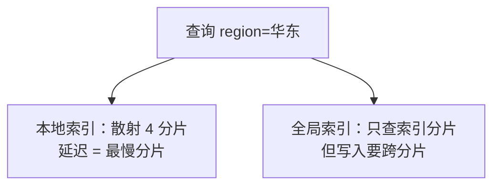

id: S-7.1-01
type: simulation
chapter: §7.1 分片
title: 推演：二级索引在分片集群里的两种命运

## 推演序列

**系统**：4 分片集群，表 orders(order_id 分片键, region, status)。
需求：按 region 查订单列表。两种二级索引方案：

- **方案 A（本地索引）**：每个分片只对自己那份数据建 region 索引
- **方案 B（全局索引）**：region 索引的数据本身按 region 值分片，覆盖所有分片的数据

**步骤 1**：方案 A 查 `region = '华东'`，请求怎么走？代价随什么增长？

**步骤 2**：方案 B 查同一条件，请求怎么走？

**步骤 3**：方案 B 写入一个订单（region='华东'），发生了什么？

**步骤 4**：选择方案。

## 揭示

**步骤 1**：请求散射到**全部 4 个分片**，各查各的索引再合并（scatter-gather）。
代价随分片数线性增长——分片越多，这种查询越慢，尾部延迟由最慢分片决定。

**步骤 2**：只读 region 索引所在的分片（'华东'只在一个索引分片上），
一次点查搞定，与总分片数无关。

**步骤 3**：写入要**跨两个分片**：订单本体写入分片键所在分片，
同时更新 region 索引分片。这两个写入无法用一个本地事务包裹
（跨分片分布式事务，见第 8 章的代价）——所以全局索引普遍是**异步更新**，
读索引可能看到稍旧的订单列表。

**步骤 4**：MongoDB 的选择：本地索引（查询必须 scattering）；
DynamoDB/Couchbase 的选择：全局二级索引（写入放大 + 最终一致）。
**规律：二级索引让"读路径 shortest"和"写路径 single-shard"不可兼得。**

## 图
两种索引的请求路径：

## 自测
- 单选: 本地二级索引查询的代价随什么增长？ | 索引大小 | 分片数（scatter-gather）* | 节点内存 | 网络带宽
- 判断: 全局二级索引的更新通常与主数据写入在同一分片事务内完成。 [错]

## 原文关联
- [§7.4 分片与二级索引](/ch7/#sec_sharding_secondary_indexes)
- [§7.4 本地二级索引](/ch7/#id166)
- [§7.4 全局二级索引](/ch7/#id167)
