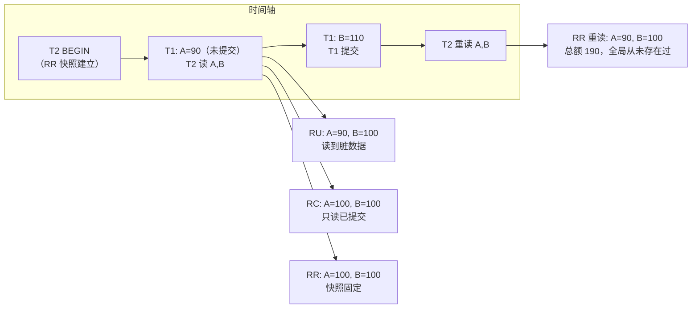

id: S-8.2-01
type: simulation
chapter: §8 事务
title: 四种隔离级别下，这笔并发读取各看到什么？

## 推演序列

**初始状态**：账户 A 余额 100，账户 B 余额 100。
两个事务并发执行：

- **T1（转账）**：BEGIN → A 扣 10（A=90）→ ……尚在执行……
- **T2（统计）**：BEGIN → 读 A → 读 B → COMMIT

**时间轴**：
T1 执行了"A 扣 10"但**尚未提交**；T2 此刻读 A 和 B。

**逐级推演**（先自己回答再看揭示）：
RU 下 T2 读到的 A、B 各是多少？
RC 下呢？RR 下呢？

**追加时间轴**：T1 继续执行 B 加 10（B=110），T1 提交。
假设 T2 是 RR 级别且**在 T1 提交前就已开始**，T2 此刻重读 A 和 B
（再算一次总额），读到多少？

## 揭示

**RU**：A=90，B=100。**读到了未提交的扣减**。
如果 T1 之后回滚，T2 看到过一笔从未发生的扣款——脏读。
总额 190，既不是转账前也不是转账后，哪个都不对。

**RC**：A=100，B=100。只读已提交数据，总额 200，一致。
但注意：T1 提交后 T2 若**再读一次**，会看到 A=90——
同一事务内两次读结果不同（不可重复读），RC 允许。

**RR**：A=100，B=100，且 T1 提交后重读仍是 100——
快照固定在事务开始时刻。总额恒为 200。

**追加推演（RR 重读）**：A=90，B=100——**注意 B 还是 100！**
T1 对 B 的写入发生在 T2 快照之后，T2 看不到。
这就是 MVCC 快照读的规则：整个事务只看"开始时刻的快照 +
自己写的"。总额算出 190？不——A=90、B=100，总额 190，
是一个**全局从未存在过的状态**（转账前是 200，转账后是 200）。
对报表场景这通常可接受（近似值），
对审计场景就是事故。

## 图
推演的时间轴与各隔离级别的可见性：

## 记住这一句
> RU 读脏数据、RC 允许不可重复读、RR 快照固定但可能看到"全局从未存在过的组合"，Serializable 才承诺"结果等价于某种串行顺序"。

## 自测
- 单选: 在 RR（快照隔离）下，事务内重读看到的是？ | 最新已提交数据 | 事务开始时刻的快照 + 自己的写入* | 始终为空 | 任意已提交数据
- 判断: RC 级别下，同一事务内两次读取同一行可能得到不同结果。 [对]

## 原文关联
- [§8.2 读已提交](/ch8/#sec_transactions_read_committed)
- [§8.2 快照隔离与可重复读](/ch8/#sec_transactions_snapshot_isolation)
