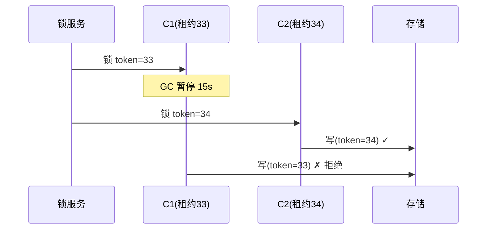

id: S-9.3-01
type: simulation
chapter: §9.3 分布式
title: 推演：进程暂停如何偷走你的锁

## 推演序列

**系统**：客户端 C1 获取分布式锁（租约 10s）操作存储节点 S，
锁保护"不能重复执行"的任务 X。

**步骤 1**：C1 拿到锁，开始执行。它需要检查"我还持有锁吗"吗？

**步骤 2**：C1 执行到一半，发生一次 15s 的 GC stop-the-world 暂停。
租约 10s 到期，锁服务把锁发给了 C2。C2 开始执行任务 X。

**步骤 3**：C1 从 GC 中醒来。它以为自己还持有锁（代码没检查），
继续写存储。现在几个客户端在执行任务 X？

**步骤 4**：怎么防？

## 揭示

**步骤 1**：不能用"查一下锁还在不在"来防——
查完、GC 暂停、再用，中间照样可能失去锁。
**租约是个时间窗承诺，不是持续状态。**

**步骤 3**：**两个客户端同时执行任务 X**。
这就是"进程暂停"的恐怖之处：从 C1 的视角，它只是执行了几行代码之间的间隙；
从全局看，15 秒过去了，世界已经变了。**GC 暂停、虚拟机挂起、
NTP 跳变都可能在任意两条指令之间插入任意长的暂停**——
单机编程里"这段代码是原子的"的直觉在分布式里全部失效。

**步骤 4**：**栅栏令牌（fencing token）**：锁服务每次发锁都发一个**单调递增的编号**。
C1 拿的是 33，C2 拿的是 34。存储节点记录见过的最大编号，
拒绝比它旧的（33 的写入被拒）。C1 醒来后继续写时自动被挡下——
它不需要"知道"自己失去了锁，编号替它说了实话。

## 图
栅栏令牌拒绝旧租约：

## 自测
- 单选: 进程暂停后"先查一下锁还在不在"为什么没用？ | 查询太慢 | 查完到使用之间仍可能再次暂停并失去锁* | 锁服务不可靠 | 没有这个问题
- 单选: 栅栏令牌靠什么机制隔离僵尸客户端？ | 更长的租约 | 单调递增编号，存储端拒绝旧编号* | 心跳检测 | 双重检查锁

## 原文关联
- [§9.3 进程暂停](/ch9/#sec_distributed_clocks_pauses)
- [§9.4 分布式锁和租约](/ch9/#sec_distributed_lock_fencing)
- [§9.4 用栅栏机制隔离僵尸与延迟请求](/ch9/#sec_distributed_fencing_tokens)
